# Работа в консольке

1) Переместиться между директориями
   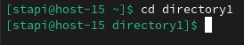  
   воспользуемся коммандой cd для перехода между директориями

   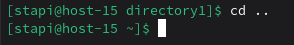  
   используем cd .. для того чтобы перейти к родительской директории
2) Вывести список файлов в директории
    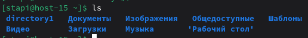  
    с помощью команды ls выведем список всех файлов
3) Вывести список Всех файлов в директории
   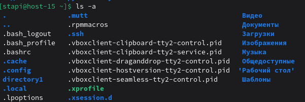  
   ls -a выведет все директории, включая скрытые
4) Создать папку с подпапками
   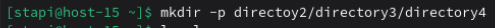  
   воспользуемся mkdir -p чтобы создать папку с подпапками
5) Внутри папки создать файлик и записать в него что-нибудь
   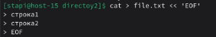  
   с помощью команды cat создадим файл и начнём вводить в него содержимое  
   с помошью EOF обозначим конец файла
6) Переместить файл из одно директории в другую
   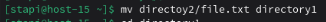  
   Используем комманду mv, чтобы перенести файл. Для этого сначала укажем, какой файл хотим перенести, а затем директорию, куда хотим перенести.  
   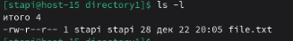  
   Перейдём в директорию, куда перенесли файл и убедимся, что там действительно есть этот файл.
7) скопировать файл из одной директории в другую
   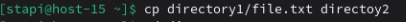  
   С помощью комманды cp скопируем этот файл в изначальную директорию
8) переименовать файл
   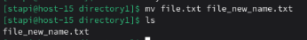  
   Переименуем файл с помощью комманды mv и убедимся что он переименовался
9)  сравнить содержимое файла
    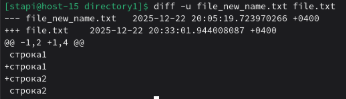  
    Используем diff -u для того чтобы сравнить содержимое двух файлов.
10) отсортировать содержимоей файла по возрастанию и убыванию
    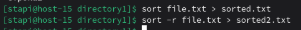  
    Используем sort для сортировки содержимого файла по возрастанаию и sort -r для сортировки по убыванию.  
    Содержимое файлов:  
    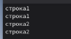  
    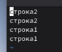
11) удалить все папки и файлы
    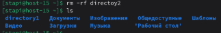
    Используем комманду rm -rf для того чтобы удалить всё содержимое указанной директории.