# Перенаправляем

1) Как работают команды >,>>?
   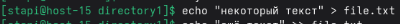  
   С помощью оператора > создаётся и перезаписывается файл с указанным текстом.  
     
   С помощью оператора >> добавим указанный текст в конец файла. Выведем содержимое:  
   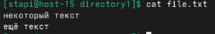
2) Что такое перенаправление ввода? stderr,stdout;
   С помощью перенаправления ввода можно вывести результат комманды или информацию об ошибке в файл.  
   Выведем в output.txt содержимое текущего каталога:  
   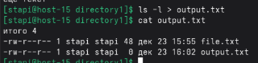  
   Выведем в errors.txt информацию об ошибке:
   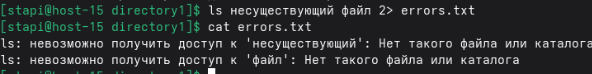
3) Выести содержание файла не используя текстовые редакторы;
   Содержимое файла можно вывести с помощью комманды cat  
   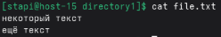
4) Создать файл с содержимым не используя текстовые редактор;
   Используя комманду cat также можно создать текстовый файл с указанным содержимым  
   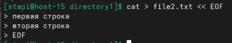
5) пернеаправить stdout в stderr и обратно на примере команды kinit, ping, tracert  
   С помощью конструкции 1>&2 можно перенаправить stdout в stderr  
   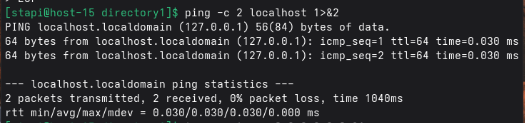  
   Конструкция 2>&1 наоборот перенаправляет stderr в stdout  
   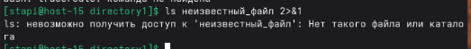
6) чем отличаются stdout и stderr  
   stdout это поток, предназначенный для вывода результата работы программы. stderr это тоже поток, в который выводятся ошибки программы.  
7) что такое stdin?  
   stdin - тоже поток, предназначенный для ввода данных в программу. В него также можно перенаправлять вывод:  
   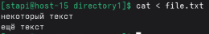
8) как отправить весь вывод команды в пустоту?  
   С помощью конструкции > /dev/null можно отправить вывод комманды в пустоту  
   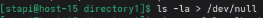  
    С помощью &> /dev/null можно отправить в пустоту в том числе и вывод об ошибке  
    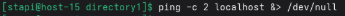
