# Управление пользователями

1) Добавьте пользователей user1 и user2:  
    1.1) user1 - оболочка bash 
      
    создание пользователя user1 в оболоче bash   
    1.2) user2 - оболочка sh  
    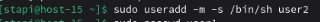  
    создание пользователя user2 в оболочке sh  
    1.3) установите им пароли  
    установление пароля для user1  
    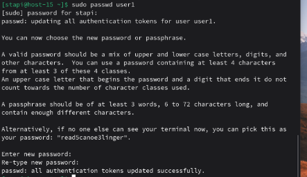  
    установление пароля для user2
    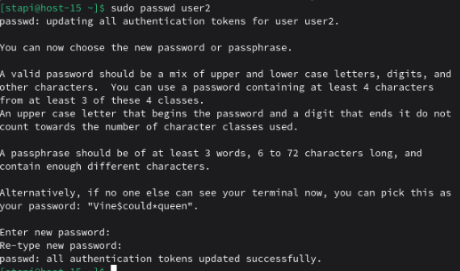  

2) Назначьте пользователю 1 группу администраторов, польователя 2 добавте в группу пользователя 1  
   назначаем user1 в группу администраторов  
   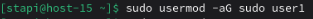  
   назначаем user2 в ту же группу, где находится user1, то есть в группу администраторов  
   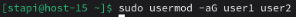  

3) Что такое права доступа? Выведите права доступа на файлы в директории пользователя  

   Права доступа (permissions) определяют, какие действия могут выполнять разные категории пользователей с файлами и директориями. Права делятся на три категории: владелец (owner), группа (group) и другие (others) и три типа прав: чтение (r), запись (w), выполнение (x)  
   Узнаем права доступа на файлы в директории пользователя для user1  
   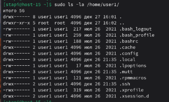  
   Узнаем права доступа на файлы в директории пользователя для user2  
   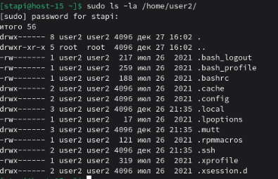  

4) Как изменить права на файлы? Создайте файл который будет на который у всез пользователей будут все возможные права  
   Создадим файл со случайным содержимым  
   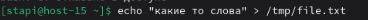  
   Установим все права для всех пользователей  
   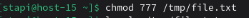  
   Теперь узнаем текущие права пользователей  
   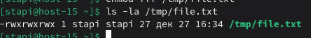

5) Как называется учётная запись встренного администратора в linux?
   Учётная запись встроенного администратора в Linux называется 'root'  

6) Как выполнить команду от имени администратора?
   1. Использование sudo: sudo <команда>
   2. Переход в root: su -

7) Есть ли ограничения у суперпользователя?  
   Нет, у суперпользователя нет ограничений
8) Удалите пользователя 2 с помощью пользователя 1.  
   Удалить юзера можно с помощью следующей команды  
   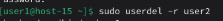  
9)  Как можно изменить владельца папки? измените владельца папки из пункта 4  
    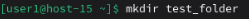  
    Создадим новую директорию от имени user1
    С помощью следующей команды изменим владельца на root  
    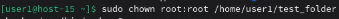  