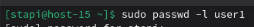
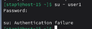

# Запрещаем

1. Запретите пользователю user1 из предыдщуего задания выполнять вход в систему  
   Запретим вход для user1 с помощью блокировку пароля  
     
   Теперь при попытке зайти появится ошибка  
     
2. Как вы это сделали?
   Запрет входа пользователю user1 был выполнен с помощью блокировки пароля. Данная команда изменяет запись пользователя в файле /etc/shadow, добавляя символ ! в начало хэша пароля. В результате пароль становится недействительным, и пользователь не может пройти аутентификацию, что приводит к ошибке при попытке входа в систему (как показано на скриншоте).
3. Какие ещё способы это сделать вы знаете?  
   1. Блокировка пароля через usermod  
   ```bash
   sudo usermod -L user1
   ```
    2. Изменение оболочки пользователя на nologin  
   ```bash
   sudo usermod -s /sbin/nologin user1
   ```
4. Можно ли создать пользователей с одинаковыми username?    
   Нельзя создать двух юзеров с одинаковым username, так как username используется как идентификатор в системных файлах