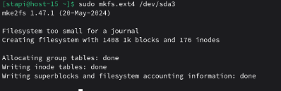
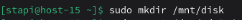
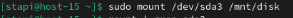
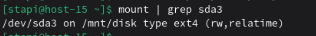
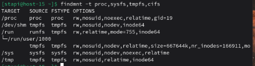
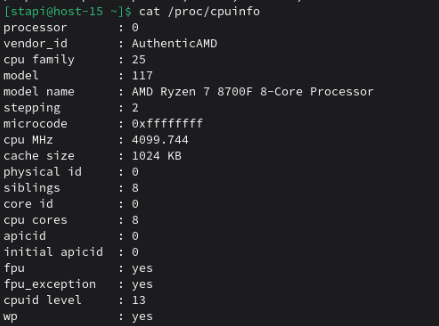
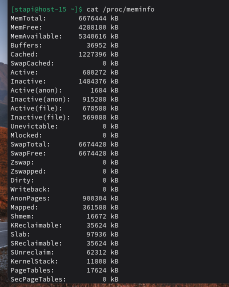
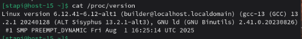
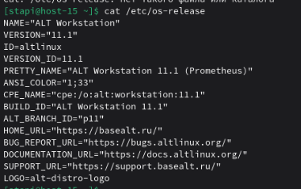

# ФС

1) Какие файловые системы вы знаете?  
   * ext2/ext3/ext4  
   * XFC
   * NTFS
   * Btrfs
  
2) Как можно классифиировать файловые системы? в чём отличия??  
    По назначению  
   * Дисковые — хранят данные на физическом носителе 
   * Сетевые — доступ к данным по сети 
   * Виртуальные — не хранят данные на диске, отражают состояние системы  
  
    По журналированию:  
    * Без журналирования — ext2
    * С журналированием — ext3, ext4, XFS  

    Журналирование повышает надёжность при сбоях питания  
3) Какие файловые системы используются в linux?  
   Чаще всего используются:
   * ext4 (по умолчанию в большинстве дистрибутивов)
   * XFS
   * Btrfs
   * ext3 / ext2
4) Как можно создать файловую систему на диске?  
   Файловую систему можно создать, используя команду sudo mkfs.ext4 /dev/sda3  
   
5) Как можно подключить диск в систему, что такое монтирование?  
   Монтирование — это процесс подключения файловой системы к каталогу.  
   Создадим каталог для монтирования файловой системы  
     
   Для монтирования введём следующую команду  
     
   Проверим монтирование  
     
6) файловая система procfs, cifs, tpmfs,sysfs. В чём особенности каждой из них? Вывести каталоги к которым примонтированы эти файловые системы  
   * procfs - виртуальная фс, в которой хранится информация о ядре и процессоре
   * sysfs - фс, хранящая информацию об устройстве и драйверах
   * tmpfs - временная фс, монтируемая в в озу  
   * cifs - сетевая фс, использующая протокол smb, предназначенная для хранения общих папок и файлов
   Выведем каталогы, к которым примонтированы эти фс  
   
7) Как можно получить информацию о системе используя лишь команду cat? Вывести ифонмацию о процессоре и состоянии памяти системы  
   Выведем информацию о процессоре  
     
   Выведем информацию о памяти  
     
   Выведем информацию о версии ядра  
     
   Выведем информацию о системе  
   

