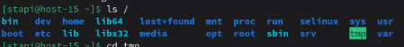
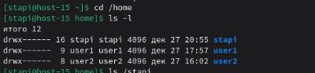

# Струтура каталогов

1) Какая структура каталогов в linux? выведите список файлов в корне системы  
   В Linux используется иерархическая древовидная структура, где корень — /, а все остальные каталоги являются его подкаталогами. Выведем содержимое корня   
     
2) Где хранятся папки пользователей в системе?  
   Домашние каталоги обычных пользователей находятся в /home. Выведем содержимое /home  
     
3) Где домашняя папка суперпользователя?  
   В домашнем каталоге root. Он отделён от home по соображениям безопасности  
4) Где хранятся основые конфигурационные файлы в системе?
   Основные конфигурационные файлы системы находятся в /etc  
   Примеры:
   * /etc/passwd — пользователи
   * /etc/fstab — монтирование дисков
   * /etc/ssh/sshd_config — настройки SSH
   * /etc/network/ — сеть
5) ЧТо за папки /bin,/sbin,usr/sbin,/usr/sbin  
   * /bin - основные команды для всех юзеров  
   * /sbin - системные утилиты администратора
   * /usr/bin - хранятся пользовательские программы  
   * /usr/sbin - хранятся административные утилиты, не критичные для загрузки
