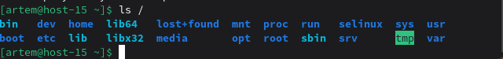

## Структура каталогов

### 1) Какая структура каталогов в Linux? Выведите список файлов в корне системы
В Linux используется иерархическая структура каталогов с корнем `/`, от которого начинаются все остальные каталоги. Список каталогов в корне системы можно вывести командой `ls /`.

### 2) Где хранятся папки пользователей в системе?
Домашние каталоги обычных пользователей располагаются в каталоге `/home`, например `/home/user`.

### 3) Где домашняя папка суперпользователя?
Домашний каталог суперпользователя `root` находится по пути `/root`.

### 4) Где хранятся основные конфигурационные файлы в системе?
Основные конфигурационные файлы системы и программ находятся в каталоге `/etc`.

### 5) Что за папки `/bin`, `/sbin`, `/usr/bin`, `/usr/sbin`?
Каталог `/bin` содержит основные пользовательские команды, необходимые для работы системы. 

Каталог `/sbin` предназначен для системных утилит администратора.

Каталог `/usr/bin` содержит большинство пользовательских программ. 

Каталог `/usr/sbin` включает дополнительные административные утилиты и службы.
