# Продолжаем

1. Выведите содержимое fstab. Что хранится в fstab?  
   Выведем содержимое fstab  
   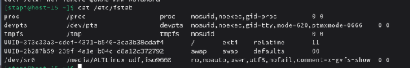  
   Этот файл содержит информацию о файловых системах, которые должны автоматически монтироваться при загрузке  
2. Добавьте в виртуальную машину ещё один диск  
   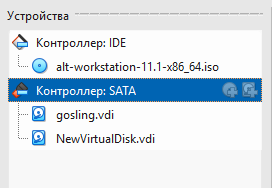  
   Создадим виртуальный диск и добавим его в виртуальную машину  
3. Узнайте как ситема видит ваш диск - выведите информацию о блочных устройствах  
   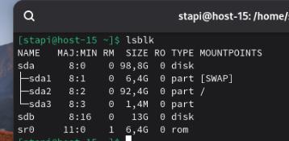  
   Выведем информацию о блочных устройствах и увидим что появился новый диск - sdb  
4. С помощью полученной информации создайте на диске таблицу разделов и фаловую систему ext4  
   Создадим таблицу разделов с помощью команды sudo fdisk /dev/sdb
   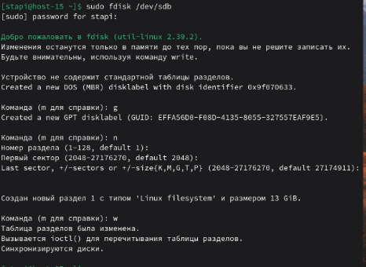  
   Создадим файловую систему  
   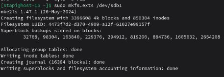
5. Примонитруте диск в каталог /mnt  
   Примонтируем диск в каталог /mnt  
   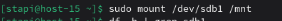  
   Проверим монтировку  
   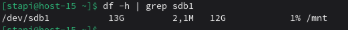
6. Зайдите в каталог и создайте там файлы  
   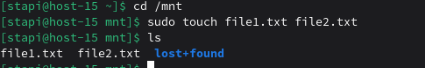  
   Перейдём в каталог /mnt и создадим там файлы   
7. Отмонтируйте диск и проверье остались ли файлы  
   Отмонтируем диск  
   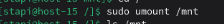  
   Проверим наличие файлов  
   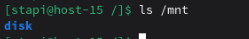  
8. Сделайте так чтобы диск автоматически подключался при загрузке систем ( добавьте информацию о нём с fstab)
   Для начала узнаем UUID диска с помощью следующей команды  
   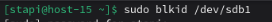  
   Откроем /etc/fstab с помощью nano  
   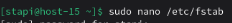  
   И добавим следующую строчку  
   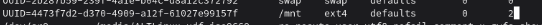    
9.  Проверьте корретность записанных в fstab данных перед перезагрузкой  
    Смонтируем все диски, указанные в файле с помощью следующей команды  
    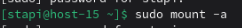  
    И проверим монтировку нашего диска  
    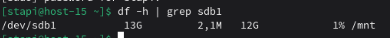
10. Перезагрущите систему и убедитесь что диск был подключён к системе  
    Перезагрузим систему и убедимся, что диск подключен и созданные файлы на месте с помощью следующих команд  
    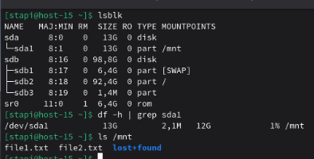