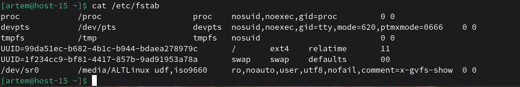
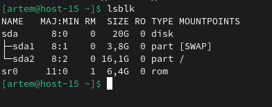
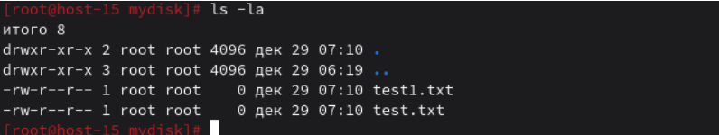

## Продолжаем

### 1) Выведите содержимое fstab. Что хранится в fstab?
```
cat /etc/fstab
```


fstab - таблица файловых систем, содержит информацию о автоматическом монтировании дисков при загрузке.
### 2) Добавьте в виртуальную машину ещё один диск
Дополнительный диск добавляется через настройки виртуальной машины в гипервизоре, после чего система может обнаружить новое устройство.

### 3) Узнайте, как система видит ваш диск — выведите информацию о блочных устройствах


### 4) С помощью полученной информации создайте на диске таблицу разделов и файловую систему ext4
```
sudo fdisk /dev/sdb

sudo mkfs.ext4 /dev/sdb1
```

### 5) Примонтируйте диск в каталог /mnt
```bash
sudo mkdir /mnt/mydisk
sudo mount /dev/sdb1 /mnt/mydisk
```
### 6) Зайдите в каталог и создайте там файлы
```bash
cd /mnt/mydisk
sudo touch test1.txt test2.txt
ls -la
```

### 7) Отмонтируйте диск и проверьте, остались ли файлы
```bash
cd /
sudo umount /mnt/mydisk
ls /mnt/mydisk/ 
```
### 8) Сделайте так, чтобы диск автоматически подключался при загрузке системы
```bash
sudo blkid /dev/sdb1

echo "UUID=ваш-uuid /mnt/mydisk ext4 defaults 0 2" | sudo tee -a /etc/fstab
```
### 9) Проверьте корректность записанных в fstab данных перед перезагрузкой
```bash
sudo mount -a
ls /mnt/mydisk/
```
### 10) Перезагрузите систему и убедитесь, что диск был подключён к системе
```bash
sudo reboot

ls /mnt/mydisk/
df -h | grep mydisk
```