# Продолжаем

1. Raid массивы, что такое икакие бывают  
   RAID (Redundant Array of Independent Disks) — это объединение нескольких физических дисков в один логический массив  
   * RAID 0 - Данные разделяются на блоки и равномерно распределяются («располосовываются») между всеми дисками в массиве. Минимум дисков - 2.
   * RAID 1 (Mirroring — зеркалирование). Данные записываются одновременно на оба диска — создаётся точная копия («зеркало»). Минимум дисков - 2.
   * RAID 5 - Данные и информация для восстановления (паритет) распределяются между всеми дисками. Паритет позволяет восстановить данные при выходе одного диска. Минимум дисков - 3.
   * RAID 6 - Аналог RAID 5, но с двумя блоками паритета. Позволяет выдержать одновременный отказ двух дисков. Минимум дисков - 4.
   * RAID 10 (RAID 1+0) - Сочетает RAID 1 и RAID 0: сначала создаются зеркала (RAID 1), затем они объединяются в полосу (RAID 0). Минимум дисков - 4.
2. Добавьте в виртуальную машину 2 диска отформатируйте их в ext4
   Добавим два новых виртуальных диска через настройки виртуальной машины  
   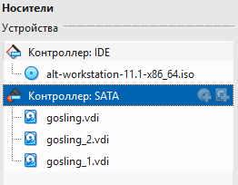  
   Создадим разделы с помощью следующих команд  
   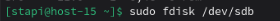  
   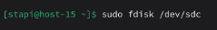  
   Форматируем диски  
   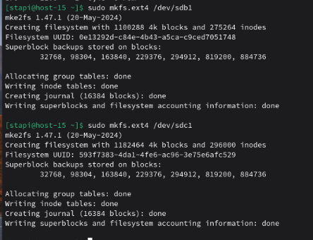
3. Создайте из них raid 0 массив  
    Создадим raid 0 массив  
    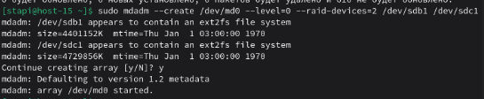  
    Создадим фс  
    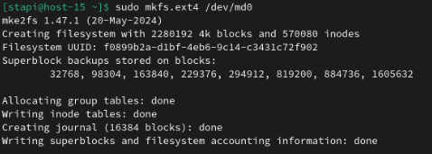  
    Отмонтируем raid 0 массив  
    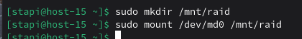
4. Проверье всё ли работает  
   Выведем список дисков  
   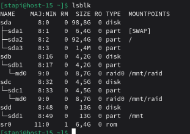  
   Заметим что появился raid 0 массив md0  
   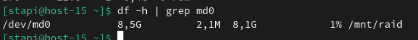
5. Удалите raid0 и создайте raid1  
   Удалим raid 0 масссив  
   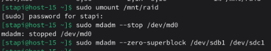  
   Создадим raid 1 массив  
   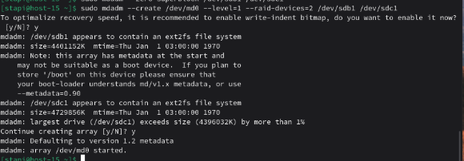  
    Создадим фс  
    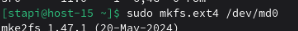  
    Отмонтируем raid 1 массив  
    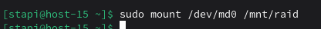
6. В чём между ними разница?  
   RAID 0 и RAID 1 отличаются принципом хранения данных и целями использования.  
    RAID 0 использует чередование данных между дисками. Он увеличивает производительность и позволяет использовать весь объём всех дисков, но не имеет отказоустойчивости. При выходе из строя одного диска теряются все данные.  
    RAID 1 использует зеркалирование. Все данные полностью дублируются на каждом диске. Это обеспечивает высокую надёжность, но полезный объём равен объёму одного диска, независимо от их количества.
7. Есть ли файловые системы которые поддерживают raid массивы без стороненго ПО  
   Да, существуют файловые системы, которые имеют встроенную поддержку RAID, без использования отдельных RAID-контроллеров или утилит вроде mdadm. К таким файловым системам относятся Btrfs и ZFS.
8. Можно ли создать raid массив во время установки системы?  
   Большинство установщиков современных дистрибутивов (Debian, Ubuntu, ALT Linux, CentOS и др.) позволяют создать raid массивы при установке.
