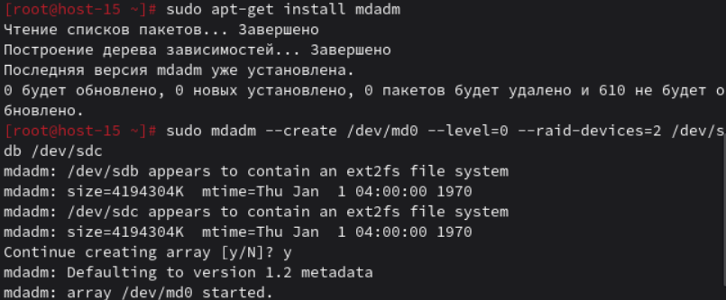

# Продолжаем

## 1. RAID массивы, что такое и какие бывают?

RAID — это объединение нескольких дисков для повышения скорости, отказоустойчивости или и того и другого.  
Основные типы: RAID 0 (скорость, без отказоустойчивости), RAID 1 (зеркалирование), RAID 5 (чётность), RAID 10 (комбинация 1 и 0).

## 2. Добавьте в виртуальную машину 2 диска и отформатируйте их в ext4
```bash
lsblk  
mkfs.ext4 /dev/sdb  
mkfs.ext4 /dev/sdc  
```

## 3. Создайте из них RAID 0 массив

```bash
mdadm --create /dev/md0 --level=0 --raid-devices=2 /dev/sdb /dev/sdc  
mkfs.ext4 /dev/md0  
```

## 4. Проверьте, всё ли работает

```bash
cat /proc/mdstat  
lsblk  
```

## 5. Удалите RAID 0 и создайте RAID 1

```bash
umount /dev/md0  
mdadm --stop /dev/md0  
mdadm --remove /dev/md0  

mdadm --create /dev/md1 --level=1 --raid-devices=2 /dev/sdb /dev/sdc  
mkfs.ext4 /dev/md1  
```


## 6. В чём между ними разница?

RAID 0 увеличивает скорость, но при отказе одного диска теряются все данные.  
RAID 1 хранит копию данных на каждом диске и переживает отказ одного диска.


## 7. Есть ли файловые системы, которые поддерживают RAID без стороннего ПО?
 
Да, например ZFS и Btrfs имеют встроенную поддержку RAID без mdadm.


## 8. Можно ли создать RAID массив во время установки системы?

Да, большинство установщиков Linux позволяют создать RAID массив прямо на этапе установки системы.
