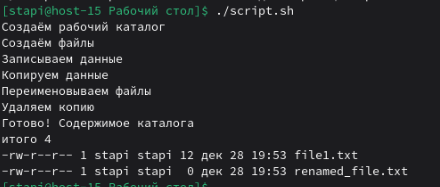

# Скриптуем по полной

1. Что такое шебанг?  
   Шебанг (shebang) — это первая строка скрипта, которая указывает, каким интерпретатором его нужно выполнять.
2. Обязательно ли исполняемый файл дожен иметь соотвествующее расширение?  
   Расширение не обязательно. В линуксе главное это наличие шебанга и права на выполнение 
3. Напишите скрипт который выполнит автоматически действия из блока работы с файлами. ( не забудьте включить set -euo pipefail для того что бы ваш скрипт было удобнее отлаживать. Опишите что включают эти флаги)  
   Напишем скрипт:
   ```bash
   #!/bin/bash

   set -euo pipefail

   WORKDIR="$HOME/file_work"
   FILE1="file1.txt"
   FILE2="file2.txt"
   COPYFILE="file1_copy.txt"

   echo "Создаём рабочий каталог"
   mkdir -p "$WORKDIR"
   cd "$WORKDIR"

   echo "Создаём файлы"
   touch "$FILE1" "$FILE2"

   echo "Записываем данные"
   echo "Hello Linux" > "$FILE1"

   echo "Копируем файл"
   cp "$FILE1" "$COPYFILE"

   echo "Переименовываем файл"
   mv "$FILE2" "renamed_file.txt"

   echo "Удаляем копию"
   rm "$COPYFILE"

   echo "Готово! Содержимое каталога:"
   ls -l
   ```

   Выполним получившийся скрипт  
     


   Cтрока set -euo pipefail делает скрипт безопаснее и удобнее для отладки. Теперь разберём по частям эту строку.  
   ```bash
   set -e
   ```
    означает, что скрипт завершится если найдена ошибка  


   ```bash
   set -u
   ```
   означает, что при использовании неициализированной переменной появится ошибка  


   ```bash 
   set -o pipefail
   ```
   означает, что если одна из команд завершится ошибкой, скрипт тоже завершится

