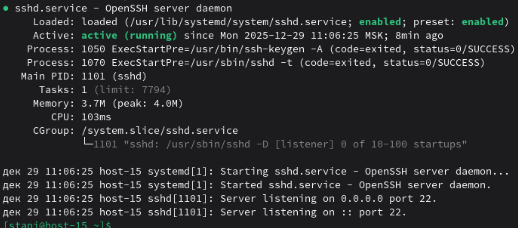
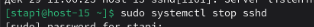
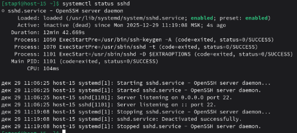
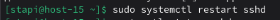
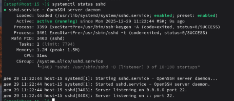
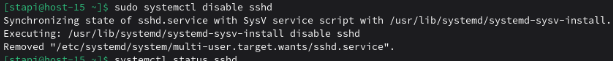
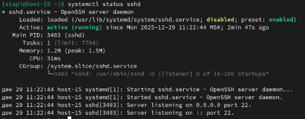
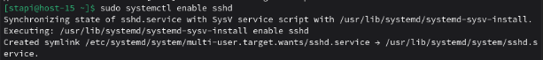
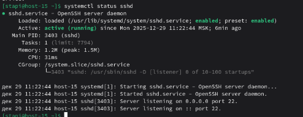
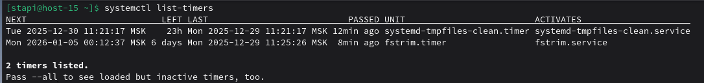

# Юниты

1. Что такое systemd юнит?  
   Systemd-юнит — это конфигурационный файл, который описывает объект, управляемый systemd. Юниты бывают разных типов:
   * service — сервисы (nginx, sshd)
   * timer — таймеры (аналог cron)
   * socket — сокеты
   * mount — точки монтирования
   * target — группы юнитов (runlevels)
2. Проверье статус любого systemd юнита, какую информацию выводит эта кманда?  
   Введём следующую команду, чтобы проверить systemd юнит, отвечающий за ssh  
     
   И увидим следующее  
   
   Здесь выведена информация о статусe (active / inactive / failed), загрузке (loaded), автозапуске (enabled / disabled), PID процесса, времени запуска, последних логах.
3. Попробуйте оставновить сервис.  
    Остановим сервис с помощью следующей команды  
      
    И выведем информацию о сервисе  
      
    Увидим, что статус стал inactive  
4. Перезапустите его.
   Перезапустим сервис с помощью следующей команды  
     
   Выведем его статус и увидим, что сервис снова стал активен  
   
5. Удалите из автозагрузки  
   Удалим из автозагрузки с помощью следующей команды  
     
   Выведем статус сервиса и увидим, что автозагрузка disabled  
   
6. Верните обратно
    Вернём автозагрузку  
      
    И выведем статус, убедившись, что автозагрузка enabled  
      
7. Что такое таймеры?  
   Systemd-таймеры — это сервис, позволяющий запускать юниты по расписанию. Таймер состоит из двух файлов: example.service и example.timer. Файл .service описывает действие, которое нужно выполнить. .timer задаёт расписание запуска service-файла. Выведем список активных таймеров  
   
