# Пишем юниты

1. Создайте скрипт который создаёт папку заполняет её файлами ( имена 1-4 ) и записывает в них информацию о текущей дате, версии ядра, имени компьютера и списе всех файлов в домашнем каталоге пользователя от которого выполняется скрипт( не забудьте сдлеать проверку на существование файлов и папок)  
   Напишем скрипт  
   ```bash
    #!/bin/bash

    cd "$HOME" || exit 1

    DIR="$HOME/info_dir"

    if [ ! -d "$DIR" ]; then
        mkdir "$DIR"
    fi

    DATE_INFO="$(date)"
    KERNEL_INFO="$(uname -r)"
    HOST_INFO="$(hostname)"
    HOME_FILES="$(ls -la "$HOME")"

    for i in {1..4}; do
        FILE="$DIR/$i.txt"
        if [ ! -f "$FILE" ]; then
            touch "$FILE"
        fi

        cat <<EOF > "$FILE"
    Дата: $DATE_INFO
    Версия ядра: $KERNEL_INFO
    Имя компьютера: $HOST_INFO

    Список файлов в домашнем каталоге:
    $HOME_FILES
    EOF
    done
    ```  
    Сделаем его исполняемым  
    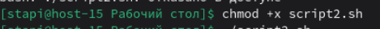

2. Создайте юнит который будет вызывать этот скрипт при запуске. Проверьте  
   Создадим следующий файл  
   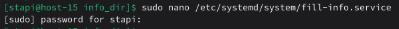  
   И запишем в него следующее содержимое  
   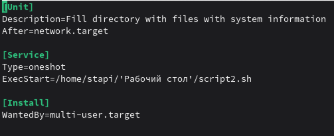  
   Выполним следующую цепочку команд, чтобы запустить и проверить сервис
   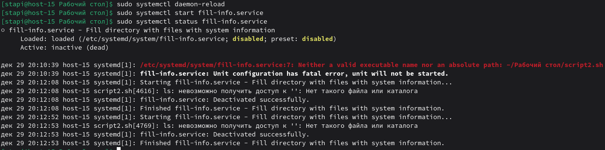  
3. Создайте таймер который будет вызывать выполнение одноимённого systemd юнита каждые 5 минут.  
   Создадим файл таймер  
   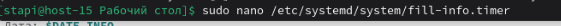  
   Заполним этот файл следующим образом  
   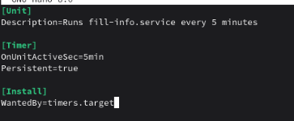  
   Запустим таймер следующей командой  
   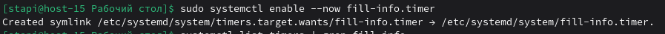  
   Проверим список таймеров  
   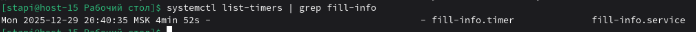  
   Проверим наличие папки, файлов и их содержимого  
   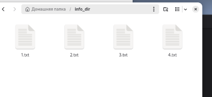  
   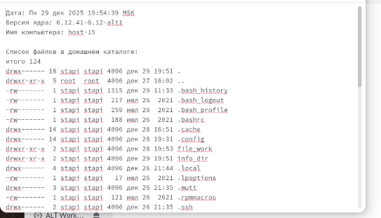
4. От какого пользователя вызыаются юниты поумолчанию?  
   По умолчанию юниты вызываются от root, если в них не указано другой пользователь
5. Создайте пользователя от имени которого будет выполняться ваш скрипт.  
   Создадим нового пользователя    
   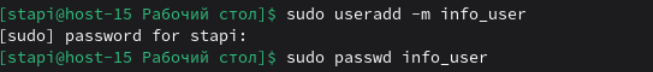
6. Дополните юнит информацией о пользователе от которого должен выплняться скрипт.  
   Изменим файл fill_info.service  
   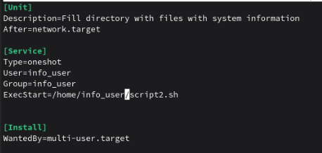  
   Запустим сервис следующими командами  
   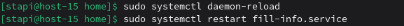
7. Дополните ваш скрипт так, что бы он независимо от местоположения всега выполнялся в домашней папке того кто его вызывает.  
   Выполнение скрипта в домашнем каталоге вызывающег уже реализовано строкой:  
   ```bash 
    cd "$HOME" || exit 1
    ```