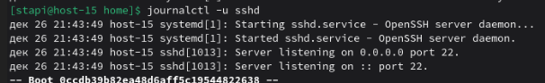
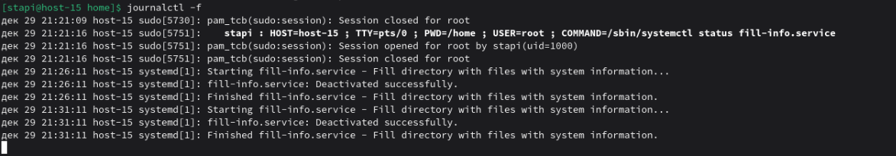
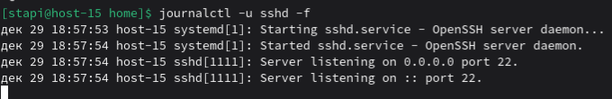

# Журнальчики

1. Посмотретите журналы ssh  
   Выведем логи ssh с помощью следующей команды  
   
2. Выведите журналы в реальном времени  
   Команда journalctl -f будет выводить журналы в реальном времени  
   
3. Выведите лог в реальном времени для службы sshd  
   Добавим флаг -f к команде из пункта 1   
   
4. Можно ли без комады journalctl прочитать логи systemd?  
   Логи хранятся /var/log/journal в бинарном виде, из за чего их чтение будет крайне затруднено
5. Сколько будет 2-2?  
   