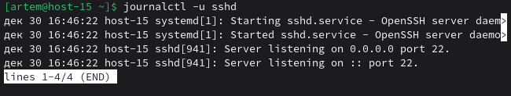
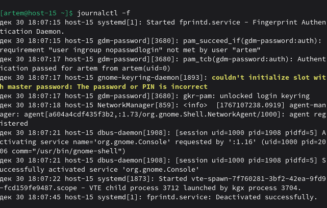
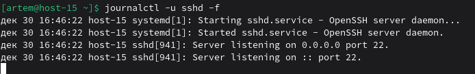

# Журнальчики

### 1) Посмотрите журналы ssh 
``` 
journalctl -u sshd  
```


### 2) Выведите журналы в реальном времени
```  
journalctl -f  
```

### 3) Выведите лог в реальном времени для службы sshd  
```
journalctl -u sshd -f  
```

### 4) Можно ли без команды journalctl прочитать логи systemd? 
Да, можно, а зачем?

Но если всё-таки нужно, то:

```bash
sudo cat /var/log/messages | grep sshd
sudo cat /var/log/syslog | grep sshd

sudo cat /var/log/sshd.log 2>/dev/null || echo "Файла нет"

sudo tail -f /var/log/daemon.log

sudo dmesg | grep ssh
```
### 5) Сколько будет 2-2? 
-Что же делать, я не знаю ответ... Точно! Надо спросить нейронку!

*Также Chat-GPT с депрессией*
