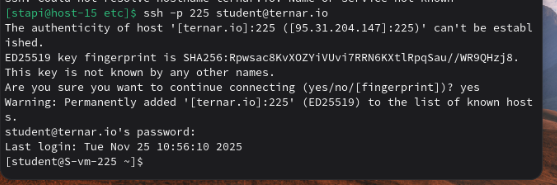
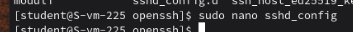
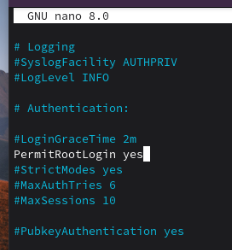
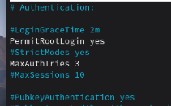
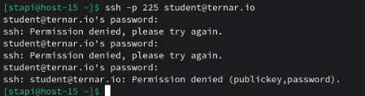
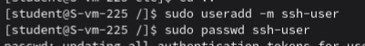
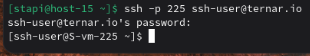
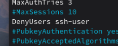
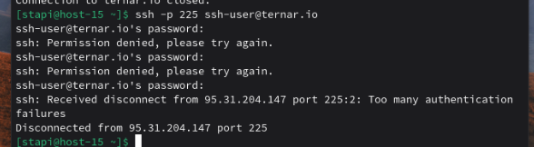

# Настриваем

1. Какой по умолчанию используется порт для поключения?  
   TCP порт 22
2. Можно ли его изменить? если да то как?  
   Нужно отредактировать конфигурационный файл SSH-сервера /etc/ssh/sshd_config. В этом файле надо найти строчку Port 22 и отредактировать на нужный порт.
3. Какая служба отвечает за обработку запросов на подключения по ssh?  
   За подключение по ssh отвечает служба sshd.
4. Какой файл конфигурации отвечает за его настройку?  
   /etc/ssh/sshd_config
5. Попробуйте подключиться по ssh к предоставленному вам серверу  
   Подключаемся к серверу через команду ssh с флагом -p для указания своего порта  
     
6. Отредактируйте файл настроек на сервере так, чтобы была возможность подключиться к серверу используя пользователя root  
   Откроем с помощью nano sshd_config  
     
   Добавим строчку PermitRootLogin yes  
   
7. Измените колличество ошибок ввода пароля перед сборосом соединения, покажите эти измененения  
   Снова откроем sshd_config и добавим строчку MaxAuthTries 3
      
    Попробуем залогиниться 3 раза неуданчо  
      
    После трёх попыток сервер откажет в новых попытках  
8. Создайте пользователя ssh-user и попробуйте им  подключиться к серверу  
   Создадим нового юзера  
     
   И подключимся через этого юзера  
   
9.  Ограничте ему возможность подключения к серверу  
    В файле sshd_config добавим следующую строчку  
      
    Теперь у ssh-user не получится залогиниться  
    
10. Как вы это сделали?  
    Через настройки SSH-сервера (sshd_config), используя директиву DenyUsers
11. Что хранится в файле known_hosts?  
    Содержит публичные ключи SSH-серверов, IP-адреса и имена хостов, и используется для проверки подлинности сервера