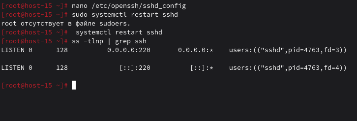
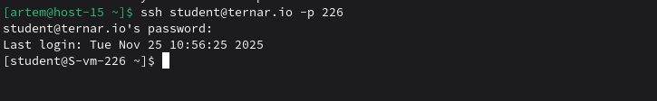
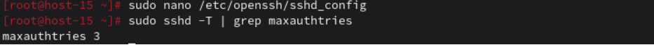
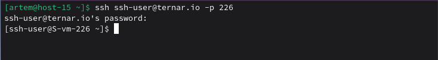

# Настриваем

### 1. Какой по умолчанию используется порт для поключения?
22
### 2. Можно ли его изменить? если да то как?
Да, это делается в файле конфигурации SSH сервера (/etc/openssh/sshd_config), там нужно изменить директиву Port.
```
sudo nano /etc/openssh/sshd_config

Меняем порт
Port 220

sudo systemctl restart sshd

sudo ss -tlnp | grep ssh
```

### 3. Какая служба отвечает за обработку запросов на подключения по ssh?
Демон sshd (OpenSSH server daemon)

### 4. Какой файл конфигурации отвечает за его настройку?
Файл конфигурации сервера — /etc/openssh/sshd_config. Для клиента есть /etc/openssh/ssh_config и ~/.openssh/config.
### 5. Попробуйте подключиться по ssh к предоставленному вам серверу
```
ssh student@ternar.io -p 229
```

### 6. Отредактируйте файл настроек на сервере так, чтобы была возможность подключиться к серверу используя пользователя root
```bash
nano /etc/openssh/sshd_config

Находим строку (скорее всего закомментирована):
PermitRootLogin prohibit-password

Меняем на:
PermitRootLogin yes

Сохраняем файл и перезапускаем sshd
sudo systemctl restart sshd
```
### 7. Измените колличество ошибок ввода пароля перед сборосом соединения, покажите эти измененения
```bash
В том же файле /etc/openssh/sshd_config:
Добавляем или изменяем директиву
MaxAuthTries 3 

Перезапускаем для применения
systemctl restart sshd

Проверяем, что настройка применилась
sshd -T | grep maxauthtries
```

### 8. Создайте пользователя ssh-user и попробуйте им подключиться к серверу.
Подклбчаемся и выполняем эти команды на сервере
```bash
sudo useradd -m -s /bin/bash ssh-user
sudo ssh ssh-user@server_ip
```

### 9. Ограничте ему возможность подключения к серверу
Редактируем конфиг через vi
```bash
sudo vi /etc/openssh/sshd_config
```
Добавляем в конец файла: 
```
Match User ssh-user
    PasswordAuthentication no
```
### 10. Как вы это сделали?
Применил директиву `Match` в файле `sshd_config`, чтобы задать настройки только для конкретного пользователя `ssh-user`. В этом блоке отключил аутентификацию по паролю (`PasswordAuthentication no`) и оставил возможность входа исключительно по SSH-ключу (`PubkeyAuthentication yes`).

### 11. Что хранится в файле known_hosts?

Файл `~/.ssh/known_hosts` содержит отпечатки (или публичные ключи) SSH-серверов, к которым вы ранее подключались. Эта информация используется для защиты от атак типа «человек посередине» (Man-in-the-Middle, MITM). При первом подключении к новому серверу SSH спрашивает, доверять ли ему, и сохраняет его ключ в этом файле.

Пример содержимого:
```
ternar.io ssh-rsa AAAAB3NzaC1yc2EAAA...DgC9 user@host
```
