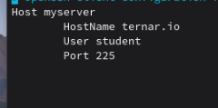
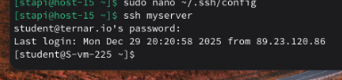

# Конфижим для удобства

1. Где хранятся пользвательские и системные настройки подключения?  
   Системные хранятся в /etc/openssh/ssh_config  
    Пользовательские хранятся в ~/.ssh/config  
2. Что за файл options?  
   Файл options в Linux — это специальный конфигурационный файл, который используется программами для хранения настроек и параметров, задающих их поведение по умолчанию.
3. Отредактируйте файл options так, чтобы можно было подключаться не вводя имя пользвателя и порт  
   Откроем файл с пользовательскими настройками подключения  
     
   Добавим в него следующие строчки  
     

4. Назовите подключение удобным для вас спсобом  
   Как видно на скрине, я назвал сервер myserver  
5. Проверьте работоспособность   
   Теперь можно подключаться не указывая сервер, порт и юзера  
   