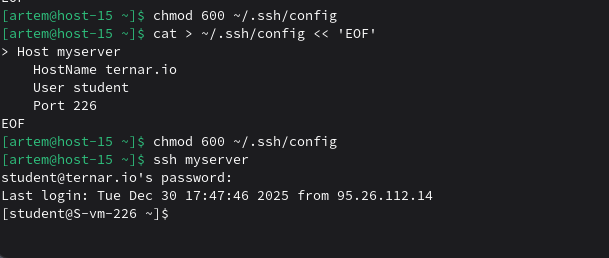

# Конфижим для удобства

### 1) Где хранятся пользовательские и системные настройки подключения?
- **Пользовательские настройки:**  
~/.ssh/config
- **Системные настройки:** 
/etc/ssh/ssh_config 
### 2) Что за файл options?
Файл `options` — это пользовательский или системный конфигурационный файл для SSH, который содержит настройки подключения: порт, имя пользователя, ключи, алиасы и прочие параметры. Обычно пользовательские опции редактируются в `~/.ssh/config`.

### 3) Отредактируйте файл options так, чтобы можно было подключаться, не вводя имя пользователя и порт
Создаём или редактируем файл `~/.ssh/config`:

```
cat > ~/.ssh/config << 'EOF'
```
Добавляем настройки для сервера:
```
Host ternar
    HostName ternar.io
    User student
    Port 226
EOF
```
Права:
```
chmod 600 ~/.ssh/config
```
Теперь достаточно команды:

```
ssh myserver
```
### 4) Назовите подключение удобным для вас способом
```
myserver
```
### 5) Проверьте работоспособность
```
ssh myserver
```
Если всё настроено верно, подключение произойдёт без указания имени пользователя и порта.
