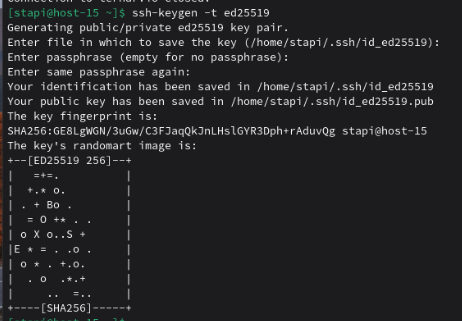
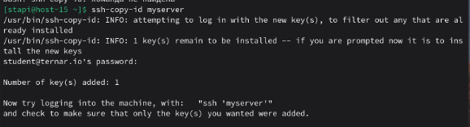
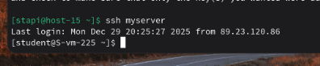
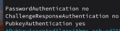

# Ключики

1. Что такое ssh ключи и зачем они нужны?  
   SSH-ключи — это способ аутентификации без пароля на основе криптографии. SSH-ключи содержат пару: приватный ключ — хранится у клиента (секретный) и публичный ключ — хранится на сервере. Используя ключи можно удобно заходить на удалённый сервер без использования пароля. 
2. Как их создать?  
   Используя команду ssh-keygen -t ed25519
3. Создайте пару публичный/приватный ключ ed_25519, где они хранятся?  
   Пропишем команду  
     
    И увидим что ключи сохранились в ~/.ssh/id_ed25519 и ~/.ssh/id_ed25519.pub для приватного и публичного ключей соответсвенно.  
4. Скопируйте публичный ключ на ваш сервер, в каком файле он будет храниться?  
   Скопируем публичный ключ на сервер, используя команду ssh-copy-id  
     
   Ключ будет хранится в ~/.ssh/authorized_keys  
5. Попробуйте подключиться к серверу, у вас запросили пароль?   
     
   Подключимся и заметим, что мы успешно подключились, не вводя пароль  
6. Запретите подключение с паролем для всех пользователей, оставьте только с помощью ключа.  
   Снова откроем /etc/ssh/sshd_config и добавим следующие строчки  
   