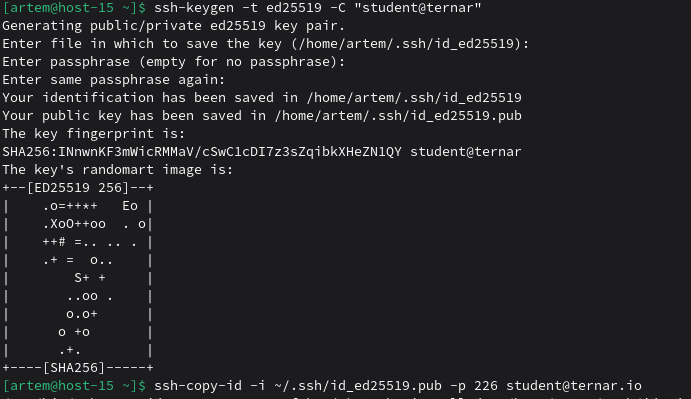
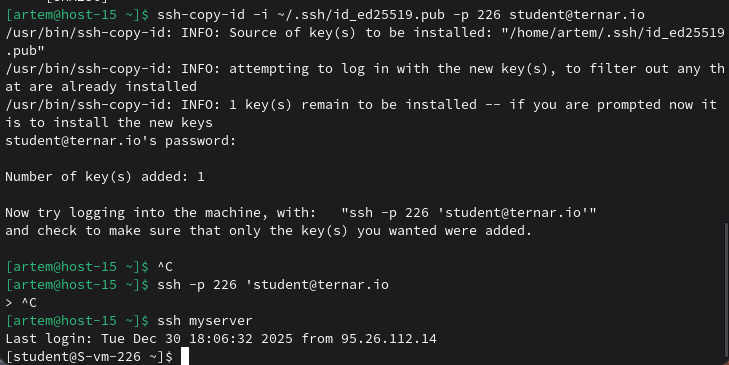
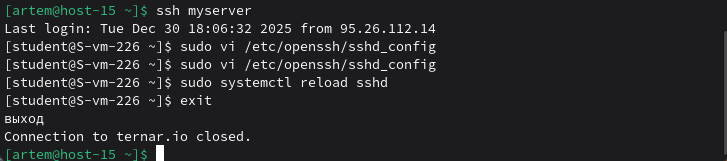

# Ключики

### 1) Что такое SSH ключи и зачем они нужны?
SSH ключи — это криптографические пары: **приватный ключ** (хранится у пользователя) и **публичный ключ** (размещается на сервере).  
Зачем нужны:
- Для безопасного аутентифицирования без пароля;
- Повышение безопасности соединения;
- Удобство автоматизированных подключений и скриптов.

### 2) Как их создать?
Используется команда `ssh-keygen`:
```
ssh-keygen -t ed25519 -C "Комментарий для ключа"
```

### 3) Создайте пару публичный/приватный ключ ed25519, где они хранятся?
```
ssh-keygen -t ed25519 -C "student@ternar"
```
- Приватный ключ: `~/.ssh/id_ed25519`
- Публичный ключ: `~/.ssh/id_ed25519.pub`



### 4) Скопируйте публичный ключ на ваш сервер, в каком файле он будет храниться?
ssh-copy-id -i ~/.ssh/id_ed25519.pub username@server_ip

Публичный ключ хранится на сервере в файле:
```
~/.ssh/authorized_keys
```
### 5) Попробуйте подключиться к серверу, у вас запросили пароль?
```
ssh username@server_ip
```
Если всё настроено правильно, пароль больше не запрашивается.


### 6) Запретите подключение с паролем для всех пользователей, оставьте только с помощью ключа
На сервере в /etc/openssh/sshd_config
```bash
sudo vi /etc/openssh/sshd_config
```

```
PasswordAuthentication no
ChallengeResponseAuthentication no
```
Затем:
```
sudo systemctl reload sshd
```
