# Шарим

1. Установите пакет samba  
   Установим samba  
   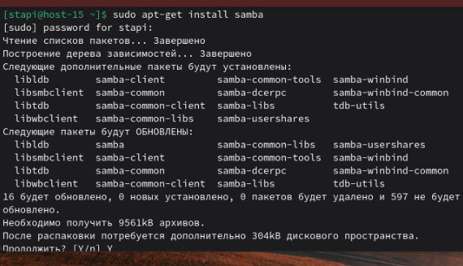
   
2. ЧТо такое побщая папка, зачем оно может быть нужно?  
   Общая папка — это директория на сервере, доступ к которой предоставлен по сети другим компьютерам по протоколам SMB/CIFS (для Windows, macOS, Linux) или другим сетевым протоколам.
3. Создайте общую папку без пароля с правами только на чтение файлов  
   Создадим папку и установим для неё соответствующий режим  
   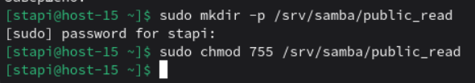  
   Откроем файл /etc/samba/smb.conf и добавим в конец следующие строки  
   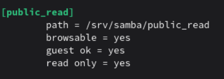  
4. Создайте общую папку с паролем с правами на чтение и запись  
   Создадим нового юзера  
   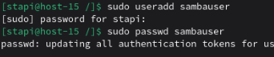  
    Добавляем пользователя в Samba  
    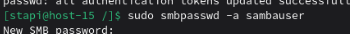  
    Создадим папку, изменим ей владельца и установим соответствующий режим доступа  
    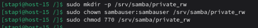  
    Добавим в /etc/samba/smb.conf следущие строчки  
    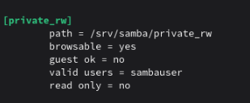
5. Создайте общую папку с доступом для какой-то группы с полными правами  
   Создадим новых юзеров и добавим их в группу  
   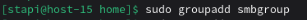  
   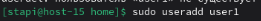  
   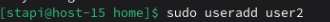  
    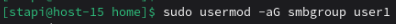  
      
    Далее добавим пользователей в Samba  
    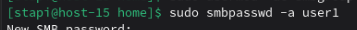  
    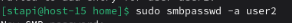  
    Создадим нужную директорию  
    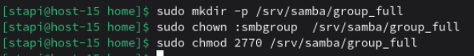  
    Откроем /etc/samba/smb.conf и добавим следующие строки  
    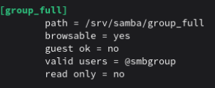  
6. Создайте общую папку в которой у одной группы будет полный доступ, а у другой только доступ на чтение. Третья группа не должна иметь к ней доступа  
   Создадим группы  
   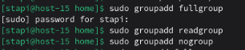  
   Создадим пользователей  
   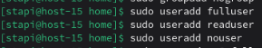  
   Добавим пользователей в соответствующие группы  
   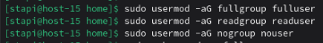  
   Добавим пользователей в Samba  
   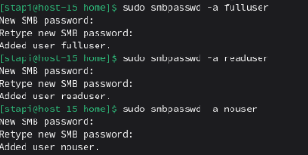  
   Создадим нужную директорию  
   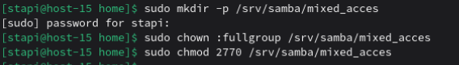  
   Откроем /etc/samba/smb.conf и добавим следующие строки  
   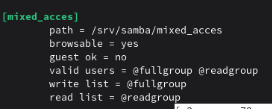
