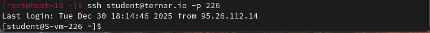

# Открываем iptables

# Открываем iptables

### 1) Установите iptables
```
sudo apt-get install iptables iptables-persistent
```
### 2) Проверьте осталась ли возможность подключения по SSH
```
ssh student@ternar.io -p 226
```

### 3) Почему может пропасть такая возможность?
- Правила `iptables` могут блокировать входящий порт SSH (по умолчанию 22);
- Неправильная последовательность правил или политика `DROP` для входящих соединений.

### 4) Откройте нужный порт на сервере чтобы восстановить подключение
```
sudo iptables -A INPUT -p tcp --dport 226 -j ACCEPT

sudo iptables -L -n -v
```
### 5) Это будет UDP или TCP порт?
- **TCP**, потому что SSH использует TCP для надёжного соединения.

# Сохраняем


### 6) Сохраняются ли записанные вами правила после перезагрузки?
Нет, по умолчанию правила `iptables` временные и сбрасываются после перезагрузки.

### 7) Как их сохранить?
```
sudo apt-get install iptables-persistent
или
sudo iptables-save > /etc/iptables/rules.v4
```