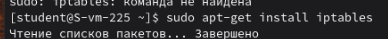
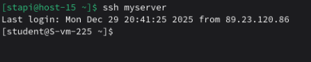
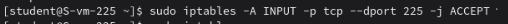
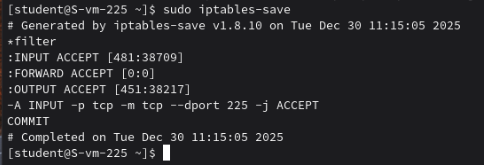

# Открываем iptables

1. Установите iptables  
   Установим iptables  
   
2. Проверьте осталась ли возможность подключения по ssh к вашему серверу  
   Возможность осталась  
     
3. Почему может пропасть такая возможность?  
   * не добавлено правило ACCEPT для SSH
   * политика цепочки INPUT установлена в DROP
   * не разрешены ESTABLISHED,RELATED соединения
4. Откройте нужный порт на сервере чтобы восстановить подключение  
   
5. Это будет udp или tcp прот?  
    tcp, так как ssh использует tcp  

# Сохраняем

6. Сохраняются ли записанные вами правила после перезагрузки?  
   Нет, по умолчанию правила iptables не сохраняются
7. Как их сохранить?  
   Использовать команду iptables-save  
     

При работе с firewall не рекомендую отключаться от текущей сессии ssh. Лучше подключаться из другой консольки.