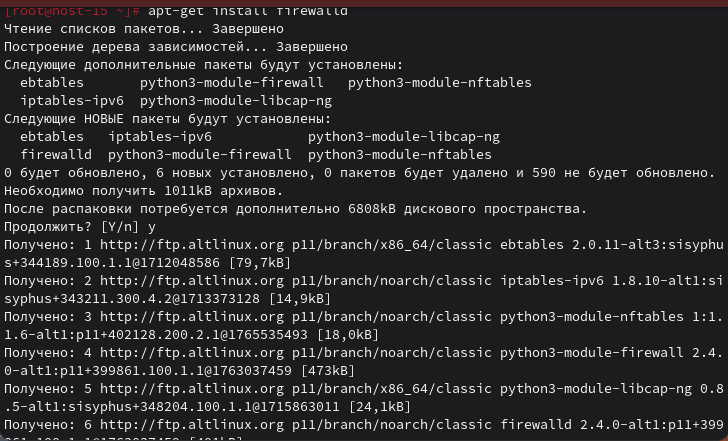
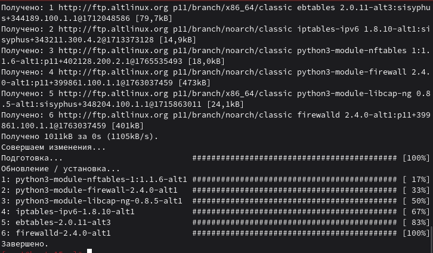
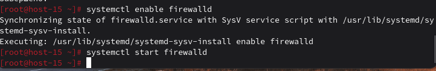
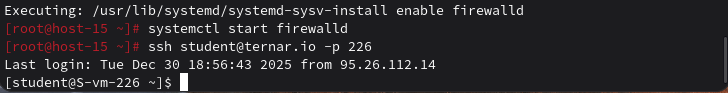
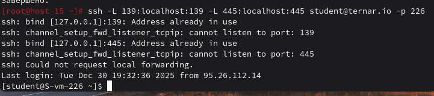

# Открываем firewalld

### 1) Удалите iptables и установите firewalld
```
apt-get remove iptables
apt-get install firewalld
systemctl enable firewalld
systemctl start firewalld
```




### 2) Попробуйте проверить возможность подключения по SSH
```
ssh student@ternar.io -p 226
```

### 3) Если подключения нет — откройте порт
```
Открываем порт 226 для SSH

sudo firewall-cmd --add-port=226/tcp --permanent
```

### 4) Выведите список открытых портов
```
sudo firewall-cmd --list-ports

Также можно вывести все разрешённые сервисы:
sudo firewall-cmd --list-services
```
### 5) Можно ли добавить порты по названию сервиса?
Да, можно. Например для SSH:
```
sudo firewall-cmd --add-service=ssh
```
### 6) Подключитесь к серверу Samba с локальной виртуальной машины
```
ssh -L 139:localhost:139 -L 445:localhost:445 student@ternar.io -p 226
```


### 7) Если не получилось — откройте нужные порты
Открываем порты Samba через firewalld
```
sudo firewall-cmd --add-service=samba --permanent
sudo firewall-cmd --add-port=139/tcp --permanent
sudo firewall-cmd --add-port=445/tcp --permanent
sudo firewall-cmd --add-port=137/udp --permanent
sudo firewall-cmd --add-port=138/udp --permanent
```
Перезагружаем правила
```
sudo firewall-cmd --reload
```
### 9) Сделайте так, чтобы изменения были постоянными
Добавляем параметр `--permanent` и перезагружаем firewall:
```
sudo firewall-cmd --permanent --add-service=ssh
sudo firewall-cmd --permanent --add-service=samba
sudo firewall-cmd --reload
```
Проверка:
```
sudo firewall-cmd --list-all
```