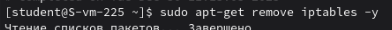
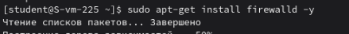
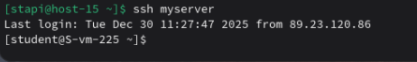
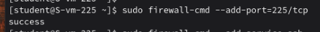
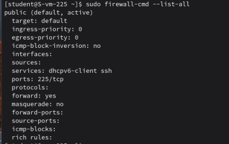
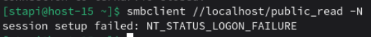
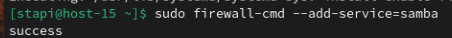

# Открываем firewald

1. Удалите iptables и установите firewalld  
   Удаляем iptables  
     
   Устанавливаем firewalld  
   
2. Попробуйте так-же проверить возможность подключения по ssh  
   Мне удалось успешно подключиться  
   
3. Если её нет то откройте порт  
   Несмотря на то что у меня получилось подключиться, открою порт  
    
4. Выведите список открытых портов с помощью firewall-cmd  
   
5. Можно ли там добавить порты по названию сервиса?
    Да, например sudo firewall-cmd --add-service=ssh. Firewalld сам знает, какие порты относятся к сервису.  

6. На вашей Локальной виртуальной машине попробуйте подключиться к серверу samba из предыдущих заданий  
   
7. Если не получилось то откройте нужные порты
   

8. Сделайте так чтобы изменения были постоянными

