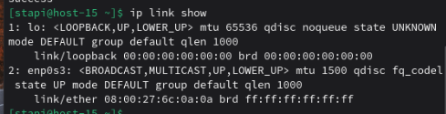
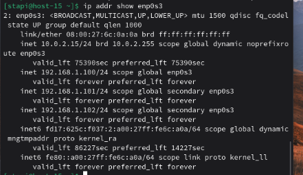
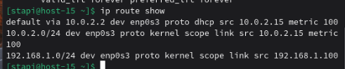
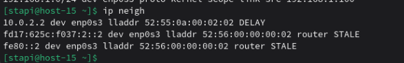

# сети

1. Выведите список интерфейсов, какими способами можно это сделать?  
     
2. Попробуйте изменить ip адрес  
   С помощью следующей команды изменим ip адресс  
   
3. Попробуте добавить несколько ip адресов на сетевую карту  
   Добавим несколько ip адрессов 
     
   И проверим список адресов  
   
4. Выведите список маршрутов  
   
5. Выведите arp таблицу  
    
6. Что такое ip адрес?  
   IP-адрес — уникальный логический адрес устройства в сети,нужен для идентификации и передачи данных.
7. Для чего нужны маршруты?  
   Маршруты определяют, куда отправлять пакеты для других сетей (через какой шлюз).  
8. Что за протокол arp?  
   ARP (Address Resolution Protocol) преобразует IP-адрес в MAC-адрес внутри локальной сети.
9.  Что такое dhcp?  
    DHCP (Dynamic Host Configuration Protocol — протокол динамической настройки узла) — сетевой протокол, позволяющий сетевым устройствам автоматически получать IP-адрес и другие параметры, необходимые для работы в сети TCP/IP.
10. Что такое dns?  
    DNS (Domain Name System - Система доменных имен) — это распределенная система в Интернете, которая переводит понятные человеку доменные имена (например, www.google.com) в числовые IP-адреса (например, 142.250.184.132)
11. Как называется один из протоколов синхронизации времени?  
    NTP (Network Time Protocol)  
    NTP (Network Time Protocol — протокол сетевого времени) — сетевой протокол для синхронизации внутренних часов компьютера
12. Что такое широковещательный запрос, зачем он нужен?  
    Широковещательный запрос (broadcast request) — это метод отправки сетевого пакета, который предназначен для одновременного получения и обработки всеми устройствами в пределах определенной сети (или ее части), используя специальные адреса (например, IP 192.168.1.255 или MAC FF:FF:FF:FF:FF:FF), чтобы запрашивать общую информацию, как в протоколах ARP или DHCP
13. Какой адресс является широковещательным?  
    Последний адрес в подсети, на которой отправляются пакеты.  
14. Какие ещё параметры можно задать сетевой карте?  
    * IP-адрес 
    * маска подсети
    * шлюз (gateway) 
    * DNS 
    * MTU 
    * MAC-адрес 
    * скорость / дуплекс 
    * VLAN
15. Что такое маска подсети? зачем она нужна?  
    Маска подсети - битовая маска, определяющая какая часть IP — сеть, а какая — хост.