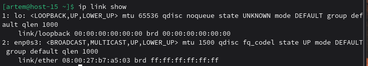
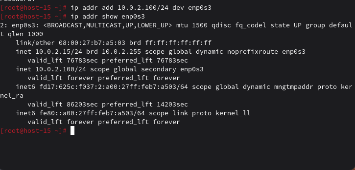
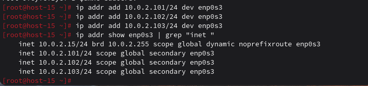
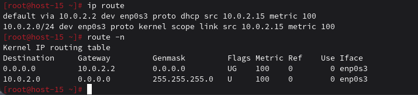
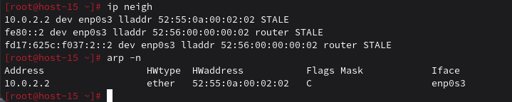

# Сети

**1) Выведите список интерфейсов, какими способами можно это сделать?**  
ip a  
ip link  
ifconfig  



### 2) Попробуйте изменить IP-адрес  
```bash
sudo ip addr add 10.0.2.100/24 dev enp0s3
ip addr show enp0s3
sudo ip addr del 10.0.2.100/24 dev enp0s3
```

### 3) Попробуйте добавить несколько IP-адресов на сетевую карту  
```bash
sudo ip addr add 10.0.2.101/24 dev enp0s3
sudo ip addr add 10.0.2.102/24 dev enp0s3
sudo ip addr add 10.0.2.103/24 dev enp0s3

ip addr show enp0s3 | grep "inet "
```

### 4) Выведите список маршрутов 
```bash 
ip route  
route -n  
```

### 5) Выведите ARP-таблицу
```bash  
ip neigh  
arp -n  
```

### 6) Что такое IP-адрес?  
Уникальный сетевой адрес устройства, используемый для его идентификации и передачи данных в сети.

### 7) Для чего нужны маршруты?  
Маршруты определяют, через какой шлюз и интерфейс отправлять сетевые пакеты к другим сетям.

**8) Что за протокол ARP?**  
Протокол, который сопоставляет IP-адрес с MAC-адресом в локальной сети.

**9) Что такое DHCP?**  
Протокол автоматической выдачи IP-адресов и сетевых параметров клиентам.

**10) Что такое DNS?**  
Система доменных имён, преобразующая доменные имена в IP-адреса.

**11) Как называется один из протоколов синхронизации времени?**  
NTP (Network Time Protocol)

**12) Что такое широковещательный запрос, зачем он нужен?**  
Запрос, отправляемый всем устройствам сети, используется для поиска узлов и сервисов (например, ARP).

**13) Какой адрес является широковещательным?**  
Последний адрес подсети, например 192.168.1.255  
Также общий широковещательный адрес: 255.255.255.255

**14) Какие ещё параметры можно задать сетевой карте?**  
MAC-адрес, MTU, скорость, duplex-режим, состояние (up/down).

**15) Что такое маска подсети? Зачем она нужна?**  
Маска подсети определяет, какая часть IP-адреса относится к сети, а какая к хосту, и нужна для маршрутизации.
