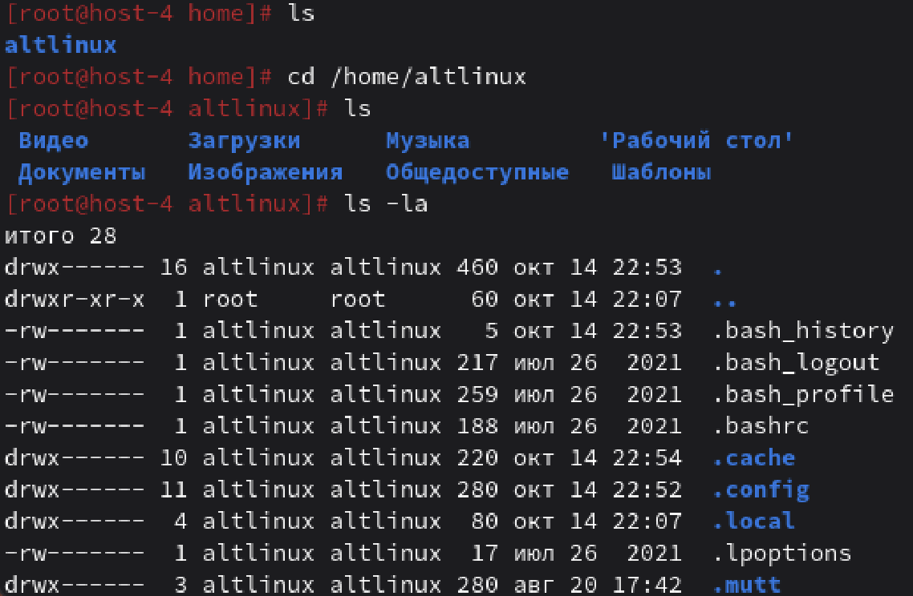
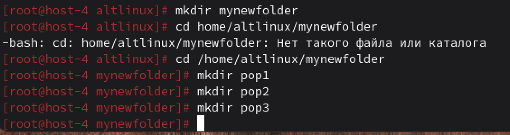
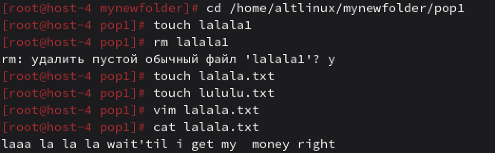
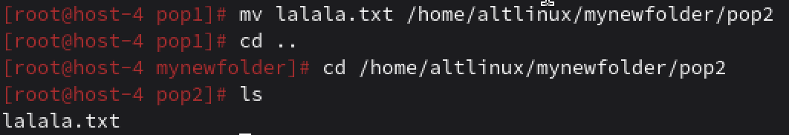
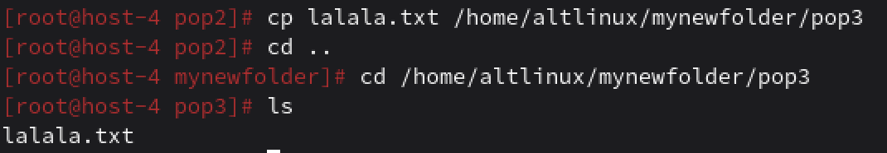
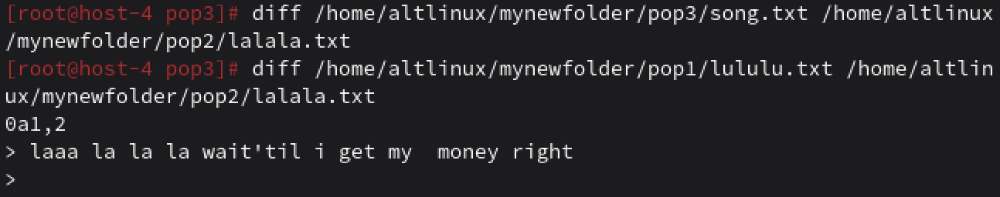
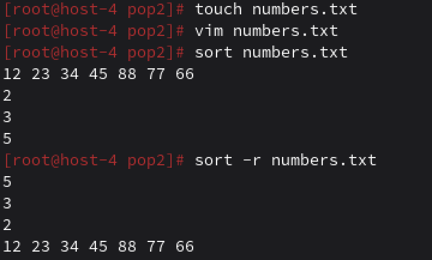
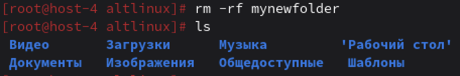

# Работа в консоли

## 1. Переместиться между директориями

Вхожу администратором. Для перемещения между директориями использую 'cd'. Можно указывать полный путь 'cd /lalala/tralala/pupupu', для перемещения в корневую директорию 'cd /', для того чтобы подняться на уровень выше 'cd ..', перейти в предыдущую директорию 'cd -', для перемещения в домашнюю директорию - 'cd ~'.

## 2. Вывести список файлов в директории

Для вывода списка файлов в директории используется 'ls'. Можно указыватьсодержимое какой именно директории ты хочешь посмотреть 'ls /lol', для просмотра подробного списка используют 'ls -l', чтобы посмотреть *.скрытые* файлы использовать 'ls -a', и 'ls -la' для вывода подробного списка всех файлов.

## 3. Вывести список Всех файлов в директории
Уже ответила, используем 'ls -a'.

## 4. Создать папку с подпапками
Для создания папки используется команда `mkdir new_folder`, потом переходим в эту папку и создаем таким же образом еще папки.

Можно было использовать и `mkdir -p mynewfolder/pop1` для создания цеопочки вложенных папок, но так как их две вложенных, то мне лень писать.

## 5. Внутри папки создать файлик и записать в него что-нибудь

Перейдя в нужную папку используем команду `touch tralala.txt` для создания txt файликов. Для записи используем vim `vim lalala.txt` для записи, для выхода esc, потом :wq. 

## 6. Переместить файл из одно директории в другую
Для этого используется команда `mv файл.txt /new/folder`

## 7. Скопировать файл из одной директории в другую
Используется команда `cp lalala.txt /folder/for/copy`

## 8. Переименовать файл
Команда `mv lalala.txt song.txt`

## 9. Cравнить содержимое файла
Используем `diff song.txt /home/user/Documents/lalala.txt`

Если есть различия - выводит их, нет - ничего не выводит.

## 10. Отсортировать содержимоей файла по возрастанию и убыванию

Коанда `sort file.txt` для сортировки по порядку и `sort -r file.txt`.

## 11. Удалить все папки и файлы

Для удаления директории со всеми вложенными в нее файлами используем `rm -rf mynewfolder`