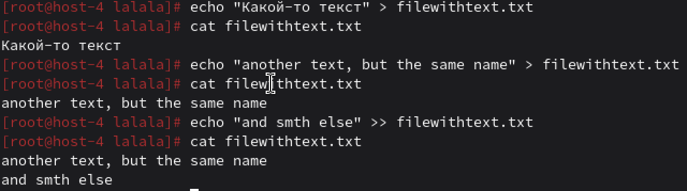
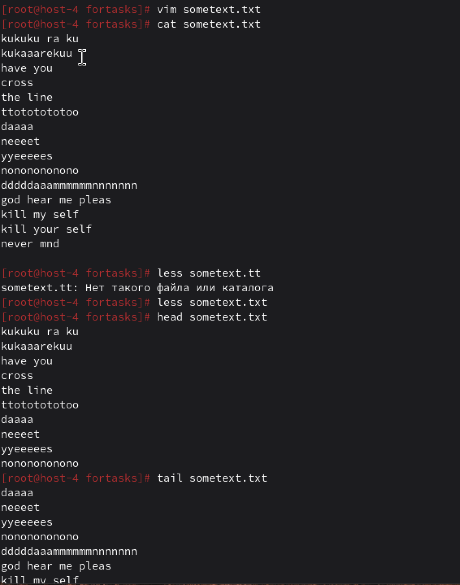
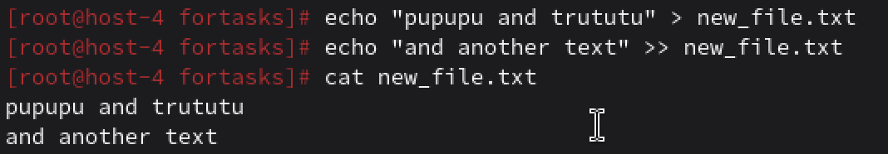
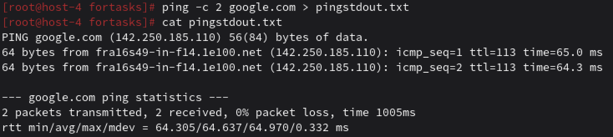
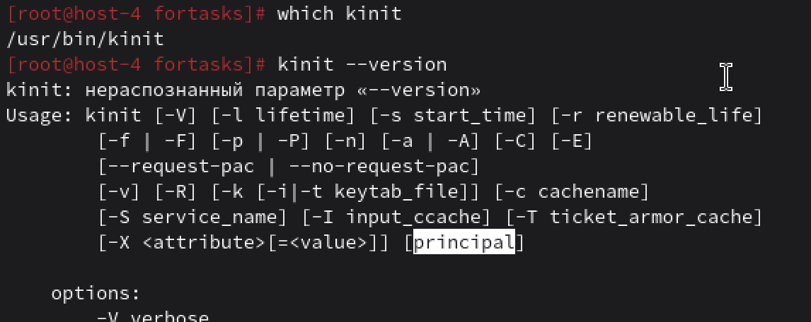
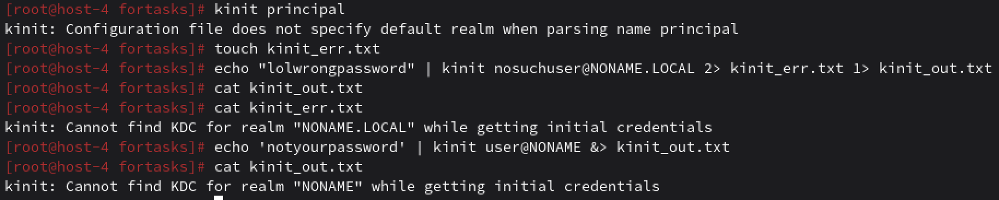
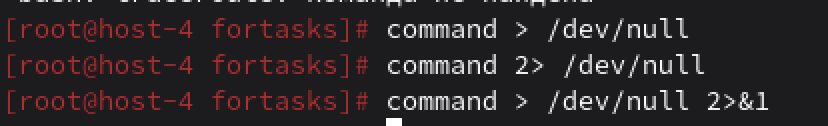

# Перенаправляем

## 1. Как работают команды >,>>?

> и >> используются для перенаправления вывода в файлы.
> для перезаписи и >> для добавления 

## 2. Что такое перенаправление ввода? stderr,stdout;

Перенаправление ввода - это такой механизм, который используют для изменения источника ввода для комманды или программы. 
Обычно мы вводим текст с клавиатуры, а вот с помощью перенаправления можно указать другой источник (файл например). 
Оператор: (команда) `<` (файл).
Для перенаправления кода можно использовать следующие команды (например):
- `ws` для подсчета строк, слов, символов в файле
- `grep` для поиска какого-нибудь слова в файле
и т.д.

stderr - стандартный поток вывода для сообщений об ошибках. Нужен для отдельной работы с ошибками
stdout - стандартный поток вывода, который используется программами для отправки данных пользователю 

## 3. Выести содержание файла не используя текстовые редакторы;

Не используя текстовые редакторы, то есть используем следующие команды:
- `cat` для вывода всего файла целиком
- `less` для построчного вывода
- `head` первые 10 строк
- `tail` последние 10 строк

## 4. Создать файл с содержимым не используя текстовые редактор;

Если не использовать текстовые редакторы, то используем перенаправление и команду `echo`

## 5. Пернеаправить stdout в stderr и обратно на примере команды kinit, ping, tracert

1> и > перенаправление stdout
2> перенаправление stderr
&> перенаправление stdout и stderr
2>&1 перенаправление stderr в stdout
1>&2 перенаправление stdout в stderr

команда `ping` для проверки доступности и времени отклика удаленного хоста

команда `kinit` для сетей, использующих протокол Kerberos, для получения и обновления билета на выдачу билетов (TGT), что позволяет пользователю аутентифицироваться в системе

установлен ли у меня kinit? Да. Пыталась ли я найти свой user@name.local? Да. Его нет... Поэтому 
с рандомным именем пыталась перенаправить stdout в stderr и обратно.

команда `traceroute`. Используется вместо команды tracert используется команда traceroute в альтах. 
Эта команда сетевая утилита для диагностики, которая показывает путь пакетов данных от компьютера до целевого сервера.

## 6. Чем отличаются stdout и stderr

Я уже писала о stdout и stderr, но ладно. Stdout для нормального вывода программы, а stderr для 
сообщений об ошибках. Stdout может быть перенаправлен, a stderr всегда виден пользователю. Stdout 
соответствует дескриптору 1, а stderr соответствует дескриптору 2.

## 7. Что такое stdin?

Stdin - это источник входных данных для программы, по умолчанию данные получаем с клавиатуры 
(`cat` .... и дальше ждем ввод с клавиатуры). `<` для перенаправления из файла. Получаем из pipe | 
`echo "hello world" | wc -w`. И многострочный ввод с клавиатуры `cat << END`.

## 8. как отправить весь вывод команды в пустоту?

Есть специальный файл, который униччтожвет все, что в него записывают.
есть несколько способов

ну и еще несколько. Но в данном скрине 1 - только stdout в пустоту, 2 - только stderr в пустоту,
3 - весь вывод (stdout + stderr) в пустоту.