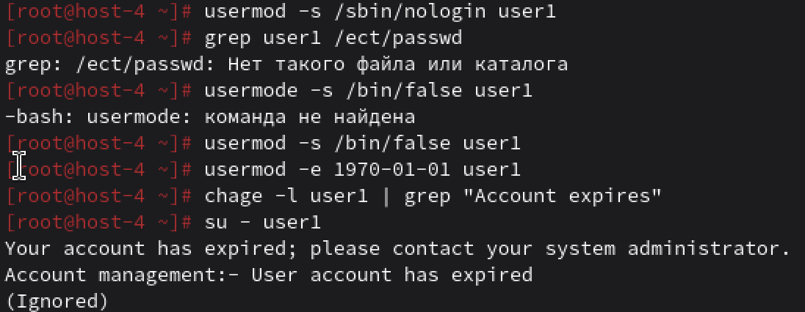

# Запрещаем

## Запретите пользователю user1 из предыдщуего задания выполнять вход в систему

Для этого блокируем учетную запись с помощью команды `usermod -L имя_пользователя`
Еще есть способ поставить срок пароля, сделать его "просроченным" и всё. `usermod -e 1`
Также можно изменить оболочку `usermod -s /bin/false имя_пользователя`

## Можно ли создать пользователей с одинаковыми username?

Если создать пользователей с одинаковым username, то система выдаст ошибку: "user already exists".