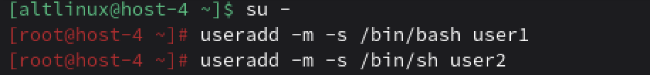
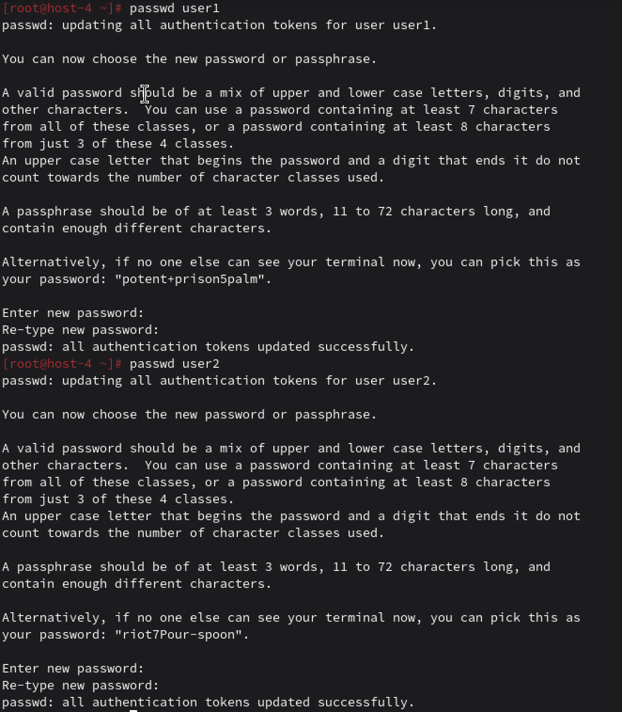
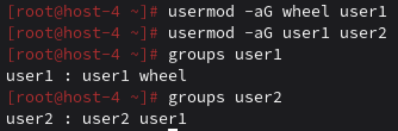
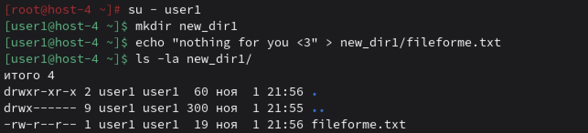
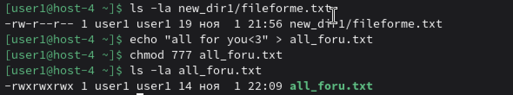
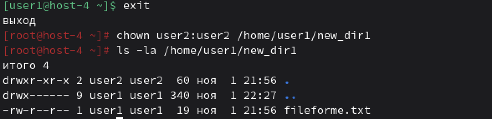
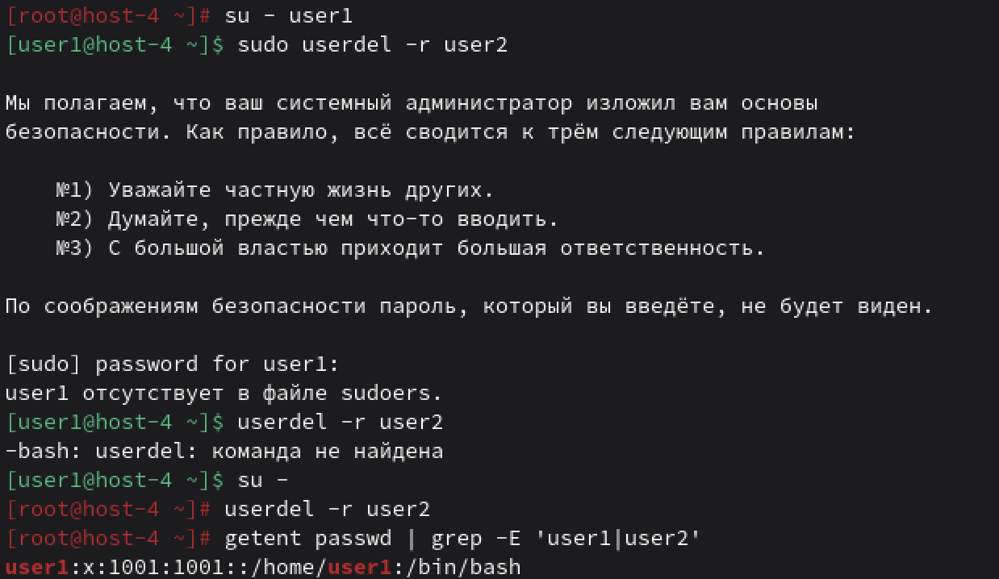

# Управление пользователями

## Добавьте пользователей user1 и user2: 1.1) user1 - оболочка bash 1.2) user2 - оболочка sh 1.3) установите им пароли

Для начала переключаемся на root и работаем от имени администратора. Используем команду `su -`. 
Добавляем пользователя user1 и user2 используя команду `useradd -m -s /bin/названиеоболочки имя_пользователя`
Для установления паролей используем `passwd`

## Назначьте пользователю 1 группу администраторов, польователя 2 добавте в группу пользователя 1

Для назначения user1 в группу администраторов используем команду `usermod -aG wheel имя_пользователя`
Для назнаения пользователя user2 в группу пользователя 1 используем команду `usermod -aG имя_хозяина имя_слуги`.
И для проверки групп пользователей мы  используес комманду `groups имя_пользователя`.

## Что такое права доступа? Выведите права доступа на файлы в директории пользователя

Права доступа это механизм контроля доступа к файлам: чтение, запись, выполнение. 
Переключаемся на пользователя user1 `su - user1`. Создаем папку и текстовый файл например от его лица. 
Потом посмотрим права доступа с помощью команды `ls -la имя_папкиorфайла`. 
Чтобы создать файл с правами доступа для всех используем команду `chmod 777 имя_файла`.

## Как изменить права на файлы? Создайте файл который будет на который у всез пользователей будут все возможные права

Изменяют права командой `chmod`, как вот сделала в предыдущем пункте. 
Можно еще например изменить владельца папки, для этого вернемся в root и пропишем слледующие команды.

## Как называется учётная запись встренного администратора в linux?

Встроенный администратор root. 

##  Как выполнить команду от имени администратора?

Выполнять через su - или sudo

## Есть ли ограничения у суперпользователя?

Нет, на то он и супер.

## Удалите пользователя 2 с помощью пользователя 1.

## Как можно изменить владельца папки? измените владельца папки из пункта 4

`chown user2:user2 /home/имя_владельца/папка`. Уже делала это выше.
