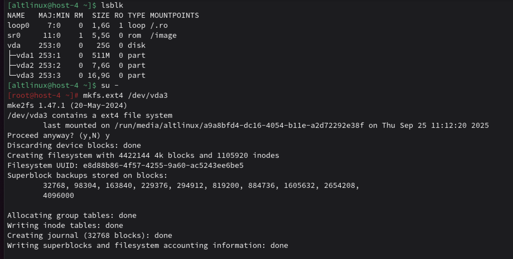
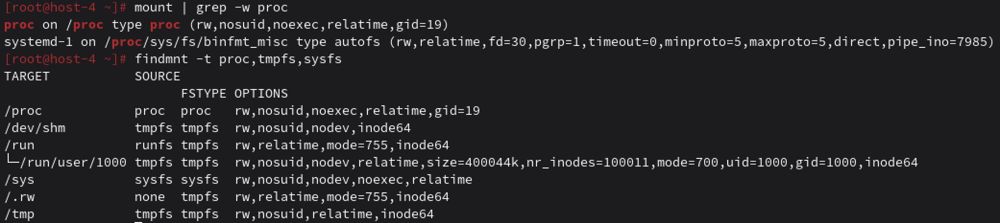

# ФС

## 1 Какие файловые системы вы знаете?

ext4 - Стандартная и наиболее распространенная ФС в современных дистрибутивах Linux. Надежная, стабильная, подходит для большинства задач.
ext3 - Предшественник ext4. Добавила журналирование к ext2.
ext2 - Очень старая, но простая и надежная ФС. Не имеет журналирования.
XFS - Высокопроизводительная ФС от Silicon Graphics. Отлично подходит для работы с большими файлами и высоконагруженных систем.
Btrfs - Современная ФС с продвинутыми функциями: снапшоты, сжатие, объединение томов (RAID), проверка целостности данных (checksum).
ZFS - Очень мощная ФС, изначально разработанная для Solaris. Имеет огромное количество функций для обеспечения целостности данных и управления томами.
NFS/NFSv4 - Сетевые файловые системы для доступа к файлам по сети.
TmpFS - Временная файловая система, которая располагается в оперативной памяти и обеспечивает очень быстрый доступ к данным, но теряет их при перезагрузке системы.
NTFS - Система файлов, используемая в Windows. ALT Linux имеет поддержку NTFS через NTFS-3G, что позволяет читать и записывать данные на NTFS-разделы.
GlusterFS - Распределенная файловая система, разработанная для масштабируемости и отказоустойчивости.
APFS - Файловая система Apple, используемая в macOS, iOS и других продуктах.
HFS+ - Предшественник APFS.
procfs - Предоставляет информацию о процессах и ядре.
sysfs - Предоставляет информацию об устройствах и драйверах.
tmpfs - ФС, размещенная в оперативной памяти. Очень быстрая, используется для временных файлов.

## 2 Как можно классифиировать файловые системы? в чём отличия??

Классификация ФС по таким признакам, как:
*По назначению:*
Дисковые (ext4, NTFS, XFS). Для хранения данных на постоянных носителях (HDD, SSD).
Сетевые (NFS, CIFS). Для доступа к файлам по сети.
Виртуальные (procfs, sysfs, tmpfs). Не имеют физического носителя, служат для взаимодействия с ядром.
*По структуре метаданных (журналирование):*
Журналируемые (ext4, XFS, NTFS). Перед записью данных в основную область операция сначала 
записывается в специальный журнал. Это позволяет быстро восстановить целостность ФС после сбоя (например, отключения электричества).
Нежурналируемые (ext2, FAT32). Не имеют журнала, поэтому проверка и восстановление после сбоя может занимать много времени.
*По внутренней структуре:*
На основе inode (ext4). Каждому файлу и каталогу соответствует уникальный индексный дескриптор (inode), который хранит метаданные.
На основе B-деревьев (XFS, Btrfs). Используют эффективные древовидные структуры для хранения данных, 
что улучшает производительность с большими каталогами и файлами.
*По месту хранения данных:*
На диске. Большинство ФС.
В оперативной памяти (tmpfs, ramfs). Очень быстрые, но все данные теряются при перезагрузке.

## 3 Какие файловые системы используются в linux?

ext4 (Fourth Extended Filesystem) - Стандартная и наиболее распространенная ФС в современных дистрибутивах Linux. Надежная, стабильная, подходит для большинства задач.
ext3 - Предшественник ext4. Добавила журналирование к ext2.
ext2 - Очень старая, но простая и надежная ФС. Не имеет журналирования.
XFS - Высокопроизводительная ФС от Silicon Graphics. Отлично подходит для работы с большими файлами и высоконагруженных систем.
Btrfs (B-Tree File System) - Современная ФС с продвинутыми функциями: снапшоты, сжатие, объединение томов (RAID), проверка целостности данных (checksum).
ZFS - Очень мощная ФС, изначально разработанная для Solaris. Имеет огромное количество функций для обеспечения целостности данных и управления томами.

## 4 Как можно создать файловую систему на диске?

Форматировввание ФС: 
для просмотра дисков и разделов пишем lsblk, для форматирования используем `mkfs.`

## 5 Как можно подключить диск в систему, что такое монтирование?

Монтирование - это процесс подключения файловой системы, расположенной на некотором диске, разделе 
или сетевом ресурсе, к определенной директории, которая будет точкой монтирования, в общем дереве каталогов Linux.
Для этого создаем папку `mkdir` и потом смонтировать файловую систему в эту директорию при помощи `mount`.
И теперь все файлы из папочки, которую мы создали в одной директории будет доступна в паппе с фс.

## 6 Файловая система procfs, cifs, tpmfs,sysfs. В чём особенности каждой из них? Вывести каталоги к которым примонтированы эти файловые системыю

**procfs** — это виртуальная файловая система, которая предоставляет доступ к информации о системных процессах и ядре 
через иерархию файлов. Она монтируется в каталог /proc и содержит файлы и подкаталоги, не существующие физически, а 
генерируемые «на лету» ядром. Эта система необходима для работы таких утилит, как ps и top, и позволяет получать данные о состоянии системы, аппаратном обеспечении и процессах в режиме реального времени. 
Каталог: /proc
*Характеристики:*
Виртуальная и динамическая: Файлы в procfs не занимают места на диске, а создаются и обновляются ядром динамически по мере изменения состояния системы.
Интерфейс к ядру: Предоставляет стандартизированный способ доступа к структурам данных ядра и информации о процессах, что позволяет пользователям и приложениям получать подробные сведения без прямого взаимодействия с ядром.
Структура каталогов: Содержит подкаталоги с именами, соответствующими идентификаторам процессов (PID).
**CIFS** (Common Internet File System) — это сетевой протокол, который позволяет получать доступ к файлам на удаленном 
сервере по сети, как если бы они были локальными. Он является расширением протокола SMB (Server Message Block) и часто 
используется взаимозаменяемо с ним, особенно в контексте совместного использования файлов и принтеров между операционными системами, такими как Windows и Linux. 
точки монтирования могут быть любыми, например, /mnt/network_share
*Характеристики:*
Совместное использование ресурсов: Основная функция CIFS — это предоставление доступа к файлам и принтерам в сети нескольким пользователям одновременно.
Протокол доступа к файлам: Это протокол прикладного уровня, который определяет, как клиентские приложения могут читать, записывать и запрашивать ресурсы у файловых серверов.
Связь с SMB: CIFS является старой публичной версией протокола SMB, и на сегодняшний день в современных операционных системах используется более новая версия протокола SMB.
Кроссплатформенная совместимость: Хотя CIFS изначально разработан Microsoft, он также используется в других операционных системах, таких как Linux и macOS, для подключения к общим ресурсам Windows.
Необходимость утилит: В Linux для монтирования общих ресурсов CIFS требуется установка специальных пакетов, например, cifs-utils.
**tmpfs** - ФС, размещенная в оперативной памяти. Очень быстрая. Все данные в ней являются временными и исчезают при перезагрузке. Часто используется для кеша, сокетов, lock-файлов и временных данных. 
Каталоги: /dev/shm (разделяемая память), /tmp (временные файлы), /run (рантайм данные, например, PID-файлы).
**sysfs** (/sys) - Это клиентская реализация протокола SMB/CIFS (используется в Windows для общих папок). Позволяет монтировать сетевые шары Windows или Samba в дерево каталогов Linux.
Каталог определяется пользователем при монтировании.

## 7 Как можно получить информацию о системе используя лишь команду cat? Вывести ифонмацию о процессоре и состоянии памяти системы

Чтобы вывести всю инфу о системе используя только команду cat, нужно понимать, что вся инфа в линукс лежит в виртуальных файлах в ФС /proc и /sys.
Поэтому достаточно ввести команду `cat /proc/cpuinfo`