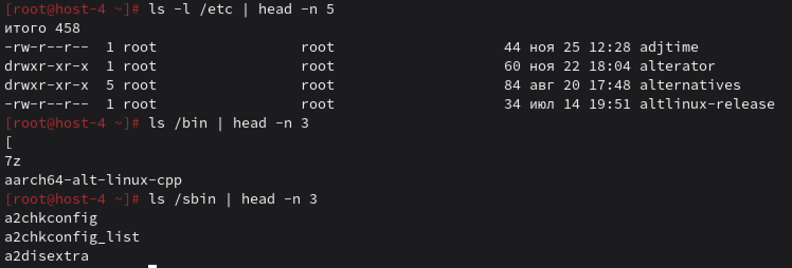

## Струтура каталогов

## 1. Какая структура каталогов в linux? выведите список файлов в корне системы

В Linux используется иерархическая файловая система с единым корнем — / (слэш). Все остальные разделы и устройства монтируются в эту иерархию.
Чтобы вывести содержимое корневого каталога: `ls /`

## 2. Где хранятся папки пользователей в системе?

Домашние каталоги обычных пользователей находятся в папке `/home`

## 3. Где домашняя папка суперпользователя?

Домашний каталог суперпользователя `/root`. не находится внутри `home`.

## 4. Где хранятся основые конфигурационные файлы в системе?

Основные системные конфигурационные файлы хранятся в каталоге `/etc`

## 5. ЧТо за папки /bin,/sbin,usr/sbin,/usr/sbin

Эти каталоги содержат исполняемые файлы, как их еще называют - бинарники:
`/bin` Основные бинарные исполняемые файлы, необходимые для работы системы в однопользовательском режиме (например, ls, cp, bash). Доступны всем пользователям.

`/sbin` Системные административные команды, требующие прав root (например, fdisk, iptables, reboot).

`/usr/bin` Вторичные исполняемые файлы пользовательских программ, установленных в системе (большинство команд, не критичных для загрузки).

`/usr/sbin` Необязательные (опциональные) системные команды, используемые администраторами (например, httpd, sshd).

