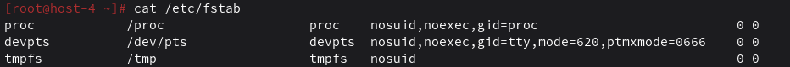
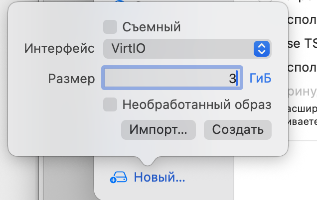
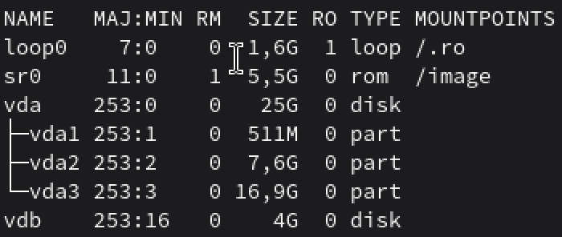
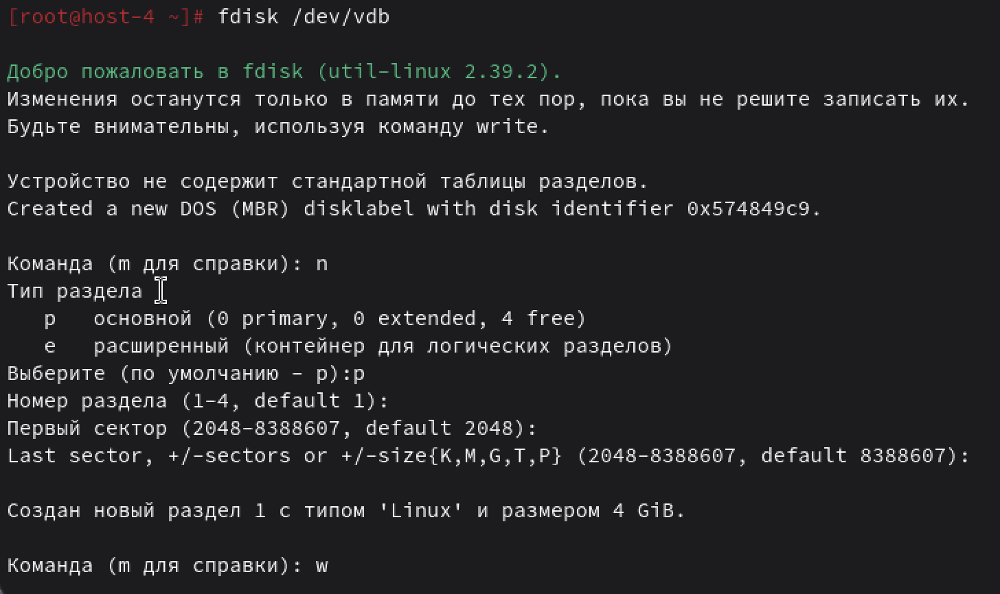
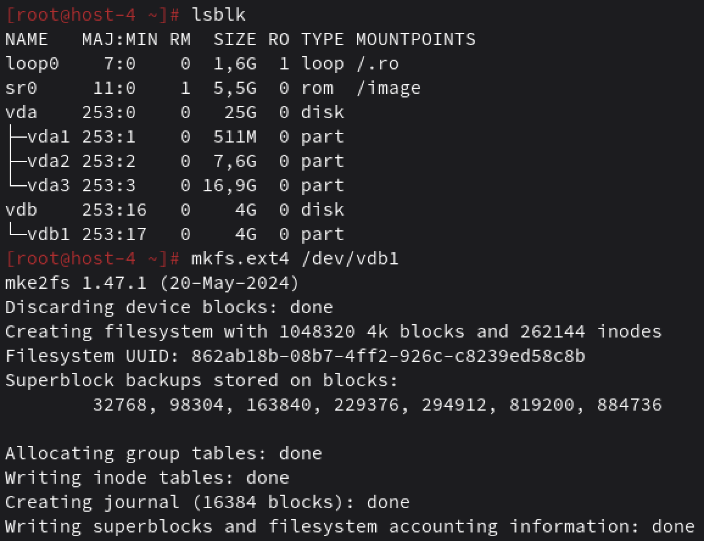
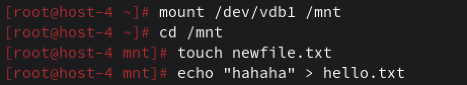
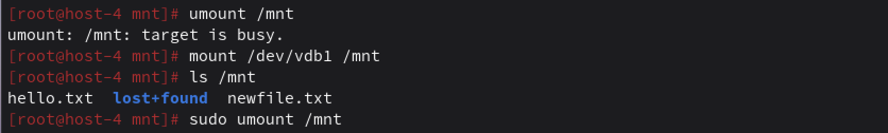
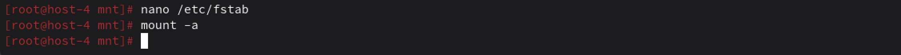

## Продолжаем

## 1. Выведите содержимое fstab. Что хранится в fstab?

В fstab хранится информация о том, какие файловые системы должны монтироваться при загрузке системы, а также их параметры.

Чтобы вывести содержимое используем cat: `cat /etc/fstab`

## 2. Добавьте в виртуальную машину ещё один диск

выключаем виртуальную машину, нажмимаем "Добавить" и выберираем "Жесткий диск". Затем выбираем нужные параметры и все. Вроде так.

## 3. Узнайте как ситема видит ваш диск - выведите информацию о блочных устройствах

Команда для просмотра: `lsblk`

Да, добавился. Там на 4гига, так как я туда сюда удаляла, добавляла, чтобы понять, что меняется. В первый раз новый диск не увидела просто.

## 4. С помощью полученной информации создайте на диске таблицу разделов и фаловую систему ext4

вызываем `fdisk`, потом по инструкции, а чтобы создать файловую систему ext4 пишем `mkfs.ext4 /dev/vdb1`

## 5. Примонитруте диск в каталог /mnt

## 6. Зайдите в каталог и создайте там файлы

## 7. Отмонтируйте диск и проверье остались ли файлы

файлы остались на диске — просто он сейчас не подключён

## 8. Сделайте так чтобы диск автоматически подключался при загрузке систем ( добавьте информацию о нём с fstab)

Узнаю UUID диска (UUID=«862ab18b-08b7-4ff2-926c-c8239ed58c8b")

команда `blkid /dev/vdb1`
потом внутри
UUID=862ab18b-08b7-4ff2-926c-c8239ed58c8b /mnt ext4 defaults 0 2

и так как команда `mount -a` не вернула ошибок, то все окей

## 9. Проверьте корретность записанных в fstab данных перед перезагрузкой

Проверили
`mount -a`

## 10. Перезагрущите систему и убедитесь что диск был подключён к системе

все супер