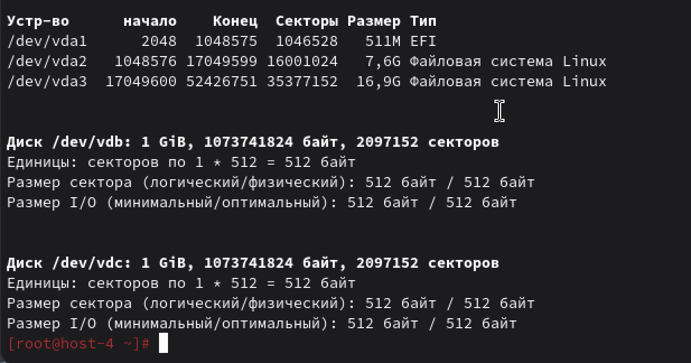
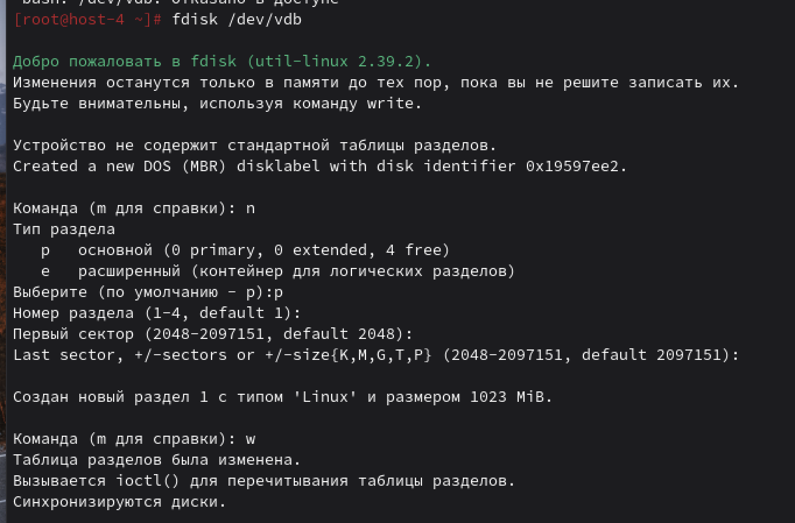
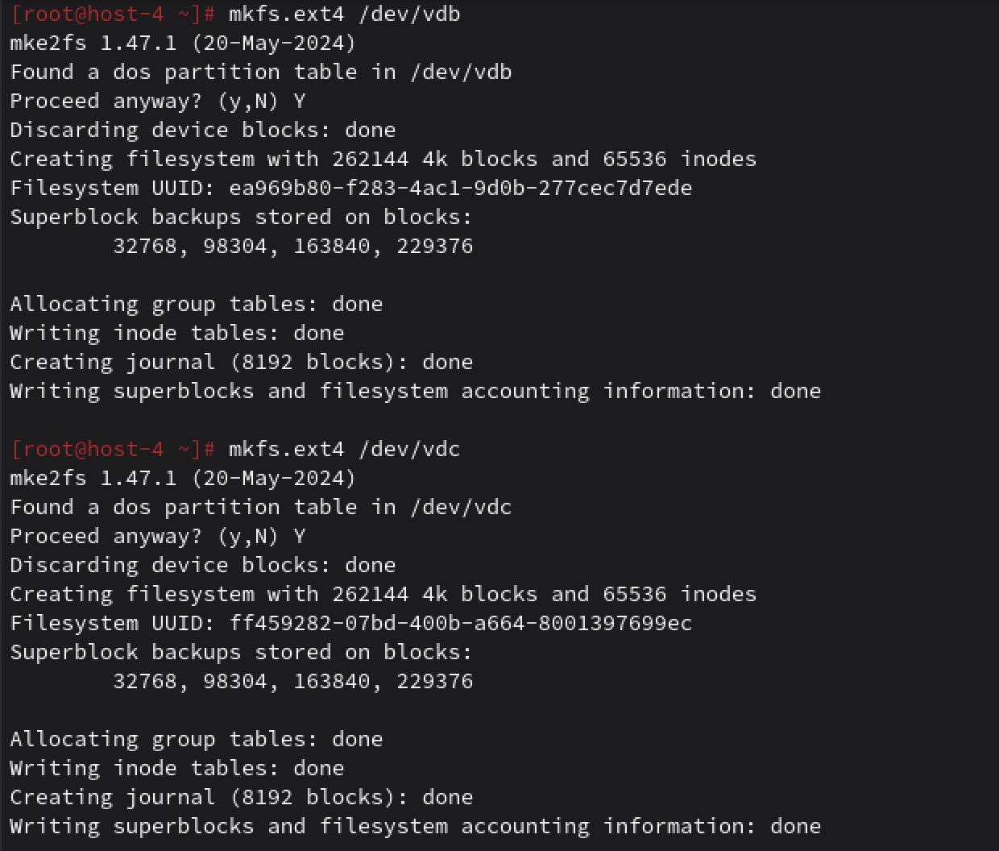
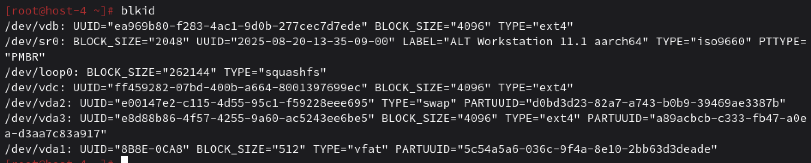
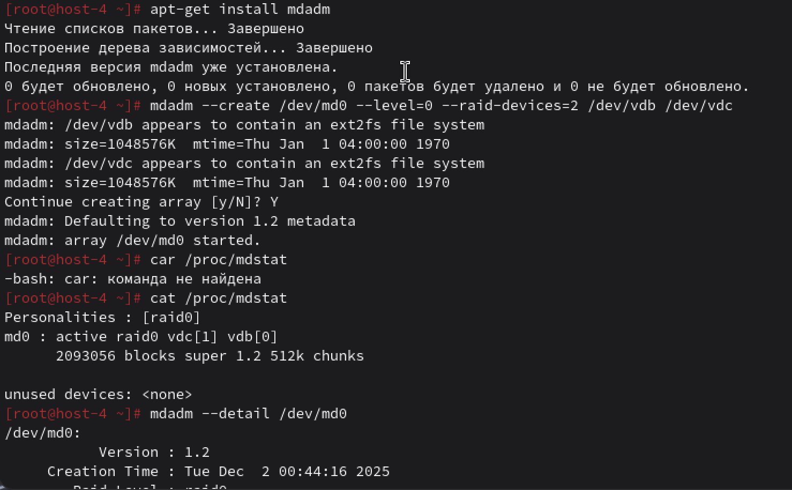
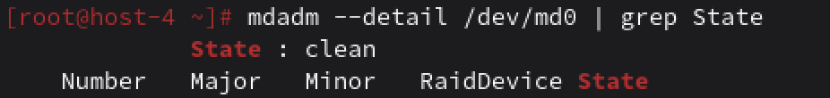
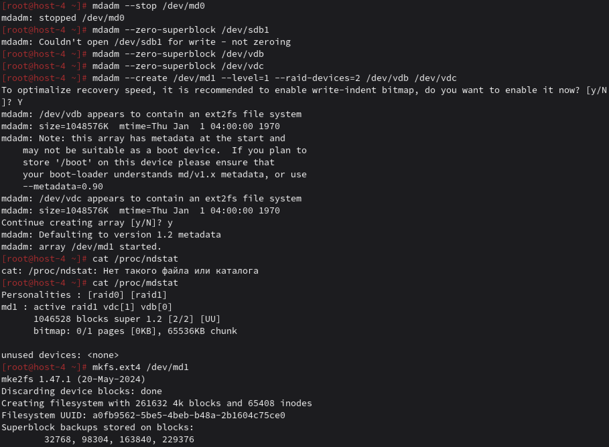
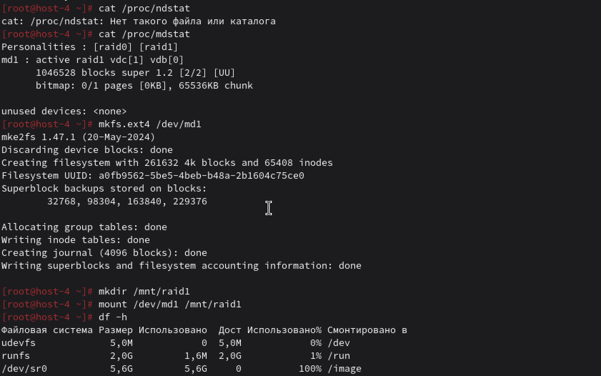

## Продолжаем

**1. Raid массивы, что такое икакие бывают**

RAID (Redundant Array of Independent Disks) — технология объединения нескольких физических дисков в логический том для повышения:
 - производительности,
 - надёжности,
 - объёма.
ТИП: RAID 0 НАЗВАНИЕ: Стрипинг МИН. ДИСКОВ: 2 НАДЕЖНОСТЬ: никакая видимо ПРОИЗВОДИТЕЛЬНОСТЬ: высокая ИСПОЛЬЗУЕМЫЙ ОБЪЕМ: все диски
ТИП: RAID 1 НАЗВАНИЕ: Зеркалирование МИН. ДИСКОВ: 2 НАДЕЖНОСТЬ: хорошая ПРОИЗВОДИТЕЛЬНОСТЬ: высокая ИСПОЛЬЗУЕМЫЙ ОБЪЕМ: 50% (зеркало)
ТИП: RAID 5 НАЗВАНИЕ: Стрипинг + чётность МИН. ДИСКОВ: 3 НАДЕЖНОСТЬ: хорошая (1 диск) ПРОИЗВОДИТЕЛЬНОСТЬ: норм ИСПОЛЬЗУЕМЫЙ ОБЪЕМ: (n−1)/n
ТИП: RAID 6 НАЗВАНИЕ: Чётность ×2 МИН. ДИСКОВ: 4 НАДЕЖНОСТЬ: хорошая (2 диск) ПРОИЗВОДИТЕЛЬНОСТЬ: норм ИСПОЛЬЗУЕМЫЙ ОБЪЕМ: (n−2)/n
ТИП: RAID 10 НАЗВАНИЕ: RAID 1 + RAID 0 МИН. ДИСКОВ: 4 НАДЕЖНОСТЬ: высокая ПРОИЗВОДИТЕЛЬНОСТЬ: высокая ИСПОЛЬЗУЕМЫЙ 50%

**2. Добавьте в ВМ 2 диска и отформатируйте их в ext4**

Для добавления дисков следующие шаги:
1) Выключить виртуальную машину
2) Добавить 2 дополнительных виртуальных диска по 1 ГБ каждый
`sudo fdisk -l` ддля проверки существующих дисков

n (новый раздел), p (primary), Enter (первый раздел), Enter (начало), Enter (конец), w (записать)
для `fdisk /dev/vdc` то же самое
потом создаём файловую систему ext4

проверяем и видим `ext4` в наших новых дисках

**3. 3. Создайте из них raid 0 массив**

`sudo apt-get install mdadm` для нужных пакетов
`sudo mdadm --create /dev/md0 --level=0 --raid-devices=2 /dev/vdb /dev/svdc` основная команда для создания RAID0 массивов
поттом создаем файловую систему для raid массивов
`sudo mkfs.ext4 /dev/md0`
`sudo mkdir /mnt/raid0` монтируем массив
`sudo mount /dev/md0 /mnt/raid0`

**4. Проверье всё ли работает**

clear - скорее всего должно быть так

**5. Удалите raid0 и создайте raid1**

`umount /mnt/raid0` размонтировать
`mdadm --stop /dev/md0` остановить RAID массив
`mdadm --zero-superblock /dev/vdb` и /dev/sdb удаляем суперблоки
`mdadm --create /dev/md1 --level=1 --raid-devices=2 /dev/vdb /dev/vdc` создаем RAID массив1
`mkfs.ext4 /dev/md1` создать файловую систему
`sudo mkdir /mnt/raid1` монтируем
`sudo mount /dev/md1 /mnt/raid1`
`df -h` для проверочки

**6. В чём между ними разница?**
Общий размер для RAID0 - cумма размеров всех дисков, для 1 - размер одного диска
Максимальная производительность у RAID0, тк параллельная запись, а у RAID1 cкорость чтения увеличивается, запись остаётся на уровне одного диска
Нет отказоустойчивости у RAID0 и у RAID 1 нет отказоустойчивости, работает даже при отказе диска
RAID 0 используется для временных данных, кэшей, где важна скорость, а 1 - для важных данных, системных разделов.

**7. Есть ли файловые системы которые поддерживают raid массивы без стороненго ПО**
Да, существуют файловые системы со встроенной поддержкой RAID:
ZFS - имеет собственные механизмы RAID-Z (аналоги RAID 5) и RAID-Z2 (аналоги RAID 6)
Btrfs - поддерживает RAID 0, RAID 1, RAID 10, RAID 5 и RAID 6 на уровне файловой системы

**8. Можно ли создать raid массив во время установки системы?**
Да.
На этапе разметки диска выбираем "Конфигуратор RAID", потом создаём RAID-массив нужного уровня, затем указываем диски для включения в массив, создаём файловую систему на RAID-устройстве и продолжаем установку как обычно.
Получается система сразу работает на отказоустойчивом массиве, упрощённое восстановление при сбоях.
