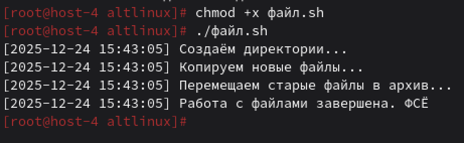

## Скриптуем

**1. Что такое шебанг?**
Шебанг — это специальная строка в начале скрипта, которая начинается с #! и указывает системе, какой интерпретатор должен выполнить этот файл.
Синтаксис `#!/путь/к/интерпретатору`
Например, чтобы выполнить скрипт через bash `#!/bin/bash`
работа:
При запуске скрипта ядро ОС читает первые 2 байта файла
Если они равны #!, ядро понимает, что это shebang и читает остальную строку до символа новой строки
Запускается указанный интерпретатор с указанными аргументами, передавая ему путь к скрипту.
Важно: должен быть на первой строке файла, начинаться с символов #!, путь к интерпретатору должен быть абсолютным.

**2. Обязательно ли исполняемый файл дожен иметь соотвествующее расширение?**
Нет.
Так как исполняемость определяется правами доступа, а не расширением файла. Например `chmod +x scriptfile` делает файл исполняемым.
Тип файла определяется по содержимому, а не по расширению.
Расширения (.sh, .py, .pl) используются для удобства, определяют тип файла и не влияют на выполнение.

пример одинаковой работы: 
`script.sh` С расширением
`my-script` Без расширения
пр этом оба имеют права на выполнение: chmod +x, оба содержат корректный шебанг, оба находятся в PATH или вызываются с указанием пути.

**3. Напишите скрипт который выполнит автоматически действия из блока работы с файлами. ( не забудьте включить set -euo pipefail для того что бы ваш скрипт было удобнее отлаживать. Опишите что включают эти флаги)**

Включаем `set -euo pipefail` в начало скрипта, чтобы он быстрее падал при ошибках.
Флаги:
set -e — выход из скрипта при первой же ошибке/ Без этого скрипт продолжит выполнение, даже если команда не сработала, что может привести к неправильным действиям
set -u — ошибка при обращении к неопределённой переменной.
Например, если написать echo $NETU_TAKOGO, а переменной NETU_TAKOGO нет, скрипт остановится.
set -o pipefail — считать ошибкой весь конвейер, если хотя бы одна команда в нём завершилась с ошибкой. Без этого set -e может не сработать, если ошибка была в первой команде, а последняя вернула 0
Напишу скрипт, который может создавать директории, копировать и перемещать файлы, удалять файлы и выводить результат-отчет.
вот сам скрипт
```
#!/usr/bin/env bash

set -euo pipefail

# Настройки
SOURCE_DIR="/home/altlinux/Загрузки"
TARGET_DIR="/home/altlinux/processed"
ARCHIVE_DIR="$TARGET_DIR/archives"
LOG_FILE="/home/altlinux/result.txt"

log() {
    echo "[$(date '+%Y-%m-%d %H:%M:%S')] $*" | tee -a "$LOG_FILE"
}

log "Создаём директории..."
mkdir -p "$TARGET_DIR" "$ARCHIVE_DIR"

# тут проверка на скрипт файл или нет
log "Копируем новые файлы..."
for file in "$SOURCE_DIR"/*; do
    [[ -f "$file" ]] || continue
    [[ "$file" == "$0" ]] && continue

    cp "$file" "$TARGET_DIR/"
    log "Скопировано: $(basename "$file")"
done

log "Перемещаем старые файлы в архив..."
find "$TARGET_DIR" -type f -mtime +7 -exec mv {} "$ARCHIVE_DIR/" \;

log "Работа с файлами завершена. ФСË"
```

получилось
