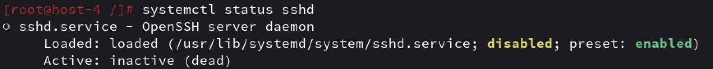
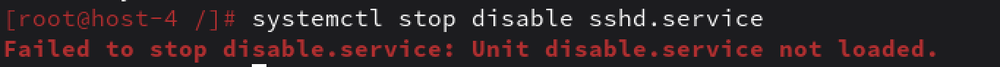
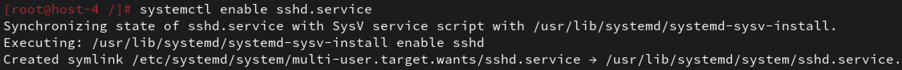

# Юниты

1. Что такое systemd юнит?
systemd юнит — это конфигурационный файл, описывающий какую‑то сущность в системе: службу, таймер, точку монтирования, сокет и т.д.
Юниты — основа работы systemd, менеджера служб и инициализации в линуксе и его детишках.
Есть несколько тайп оф юнитс:
- *.service — служба (демон), например sshd.service, nginx.service
- *.timer — таймер, запускающий сервис по расписанию
- *.mount — точка монтирования, например home.mount
- *.socket — сокет, для сокетной активации сервисов
Каждый юнит — это файл в одном из каталогов
- /usr/lib/systemd/system/ — юниты из пакетов
- /etc/systemd/system/ — юниты, созданные администратором

2. Проверье статус любого systemd юнита, какую информацию выводит эта кманда?
Команда для проверки статуса: `systemctl status <имя_юнита>`

Состояние загрузки (Loaded): loaded — конфиг юнита успешно загружен,
Общий статус (Active): inactive (dead) — служба не запущена (чет умерло)

3. ПОпробуйте оставновить сервис.

попробовала.
Что делает stop:
systemd отправляет службе сигнал SIGTERM, чтобы она завершилась корректно.
​Если служба не завершается, через некоторое время отправляется SIGKILL.

Скорее всего, мне нужно было увидеть во встором задании, что у меня статус активный, а после этой команды как раз таки на dead поменялось бы

4. Перезапустите его.
Перезапучкают след командой: `sudo systemctl restart sshd.service`
restart делает следующее: сначала останавливает службу, потом запускает её заново. После этого служба будет работать с новыми настройками

5. УДалите из автозагрузки
Чтобы сервис не запускался автоматически при загрузке, но при этом остался в системе пишут так:
`sudo systemctl disable sshd.service`
disable удаляет символическую ссылку на юнит из каталога автозагрузки, а сам файл юнита остаётся на месте
После этого при перезагрузке служба не запустится и вручную её можно запустить командой `systemctl start sshd`

6. Верните обратно


7. Что такое таймеры?
systemd таймеры — это юниты с расширением *.timer, которые позволяют запускать другие юниты по расписанию
Два вида:
- Календарные. Запускаются в определённое время, типо каждый день в 03:00, или каждую пятницу в 18:00
- Монотонные. Запускаются через заданное время после какого‑то события, например OnBootSec=5min — через 5 минут после загрузки, OnActiveSec=10min — каждые 10 минут после активации таймера.

список команд с таймерами
```
systemctl list-timers                    # список активных таймеров
systemctl status backup.timer            # статус таймера
sudo systemctl enable backup.timer       # включить таймер в автозагрузку
sudo systemctl start backup.timer        # запустить таймер вручную
```
