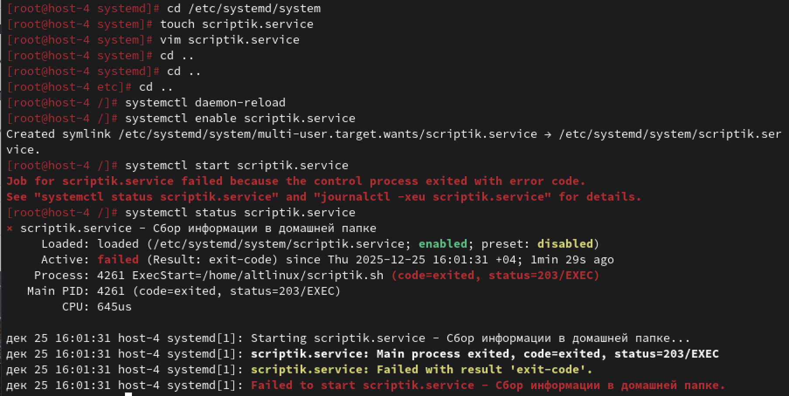
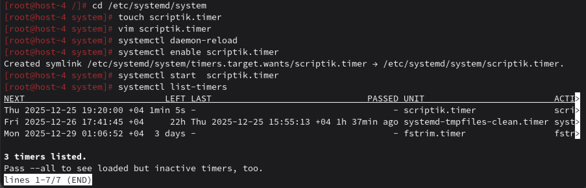

1. Создайте скрипт который создаёт папку заполняет её файлами ( имена 1-4 ) и записывает в них информацию
о текущей дате, версии ядра, имени компьютера и списе всех файлов в домашнем каталоге пользователя от которого выполняется скрипт( не забудьте сдлеать проверку на существование файлов и папок)

вот скриптик
```
#!/usr/bin/env bash

set -euo pipefail


DATA_DIR="$home/altlinux/"
FILE1="$DATA_DIR/1"
FILE2="$DATA_DIR/2"
FILE3="$DATA_DIR/3"
FILE4="$DATA_DIR/4"


if [[ -e "$DATA_DIR" ]]; then
    echo "Папка $DATA_DIR уже существует, пропускаем создание." >&2
else
    mkdir -p "$DATA_DIR"
    echo "Создана папка: $DATA_DIR"
fi


if [[ ! -e "$FILE1" ]]; then
    date '+%Y-%m-%d %H:%M:%S' > "$FILE1"
    echo "Записана дата в $FILE1"
else
    echo "Файл $FILE1 уже существует, пропускаем."
fi


if [[ ! -e "$FILE2" ]]; then
    uname -r > "$FILE2"
    echo "Записана версия ядра в $FILE2"
else
    echo "Файл $FILE2 уже существует, пропускаем."
fi


if [[ ! -e "$FILE3" ]]; then
    hostname > "$FILE3"
    echo "Записано имя хоста в $FILE3"
else
    echo "Файл $FILE3 уже существует, пропускаем."
fi


if [[ ! -e "$FILE4" ]]; then
    ls -la "$HOME" > "$FILE4"
    echo "Записан список файлов домашней папки в $FILE4"
else
    echo "Файл $FILE4 уже существует, пропускаем."
fi
```
2. Создайте юнит который будет вызывать этот скрипт при запуске. Проверьте
```
# /etc/systemd/system/scriptik.service

[Unit]
Description=Сбор информации в домашней папке
After=network.target

[Service]
Type=oneshot
ExecStart=/home/altlinux/scriptik.sh
RemainAfterExit=yes

[Install]
WantedBy=multi-user.target
```
Type=oneshot — служба выполняет скрипт и завершается, но systemd считает её активной, если RemainAfterExit=yes
After=network.target — запускать после настройки сети (на всякий)
WantedBy=multi-user.target — включить в автозагрузку для многопользовательского режима

В выводе status будет:
- имя юнита и описание;
- Loaded — загружен ли файл;
- Active — active (exited) или active (running);
- PID и время запуска;

3. Создайте таймер который будет вызывать выполнение одноимённого systemd юнита каждые 5 минут.

```
# /etc/systemd/system/scriptik.timer

[Unit]
Description=Запуск scriptik.service каждые 5 минут

[Timer]
OnCalendar=*:0/5:00
Persistent=true

[Install]
WantedBy=timers.target
```


4. От какого пользователя вызыаются юниты поумолчанию?
Системные юниты (в /etc/systemd/system/) по умолчанию запускаются от имени root.
Если в юните не указано User=, то:

ExecStart и другие команды выполняются от root;

рабочая директория — /root (если не указано WorkingDirectory=).

5. Создайте пользователя от имени которого будет выполняться ваш скрипт.
Создаём отдельного пользователя, от имени которого будет работать скрипт:
`sudo useradd -m -s /bin/bash newuser`
-m — создать домашнюю папку /home/gather_user
-s /bin/bash — оболочка по умолчанию

6. Дополните юнит информацией о пользователе от которого должен выплняться скрипт.
Чтобы дополнить опять открывать vim пришлось, чтобы поменять Service
добавляем User=newuser Group=newuser
```
# /etc/systemd/system/scriptik.service

[Unit]
Description=Сбор информации в домашней папке
After=network.target

[Service]
Type=oneshot
User=newuser
Group=newuser
ExecStart=/home/newuser/scripts/newuser.sh
WorkingDirectory=/home/newuser
RemainAfterExit=yes

[Install]
WantedBy=multi-user.target
```
WorkingDirectory=/home/туцгыук — перейти в домашнюю папку пользователя перед запуском

7. Дополните ваш скрипт так, что бы он независимо от местоположения всега выполнялся в домашней папке того кто его вызывает.
ОПЯть vim
Дополняем скрипт
```
#!/usr/bin/env bash

set -euo pipefail

cd "$home || { echo "Не удалось перейти в домашнюю папку" >&2; exit 1; }

DATA_DIR="$home/altlinux/"
FILE1="$DATA_DIR/1"
FILE2="$DATA_DIR/2"
FILE3="$DATA_DIR/3"
FILE4="$DATA_DIR/4"


if [[ -e "$DATA_DIR" ]]; then
    echo "Папка $DATA_DIR уже существует, пропускаем создание." >&2
else
    mkdir -p "$DATA_DIR"
    echo "Создана папка: $DATA_DIR"
fi


if [[ ! -e "$FILE1" ]]; then
    date '+%Y-%m-%d %H:%M:%S' > "$FILE1"
    echo "Записана дата в $FILE1"
else
    echo "Файл $FILE1 уже существует, пропускаем."
fi


if [[ ! -e "$FILE2" ]]; then
    uname -r > "$FILE2"
    echo "Записана версия ядра в $FILE2"
else
    echo "Файл $FILE2 уже существует, пропускаем."
fi


if [[ ! -e "$FILE3" ]]; then
    hostname > "$FILE3"
    echo "Записано имя хоста в $FILE3"
else
    echo "Файл $FILE3 уже существует, пропускаем."
fi


if [[ ! -e "$FILE4" ]]; then
    ls -la "$HOME" > "$FILE4"
    echo "Записан список файлов домашней папки в $FILE4"
else
    echo "Файл $FILE4 уже существует, пропускаем."
fi
```

при загрузке системы запустится scriptik.service от newuser
каждые 5 минут будет запускаться снова через таймер.