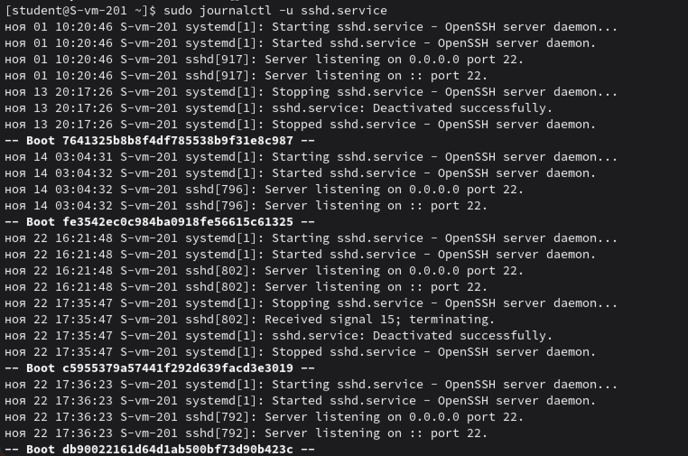
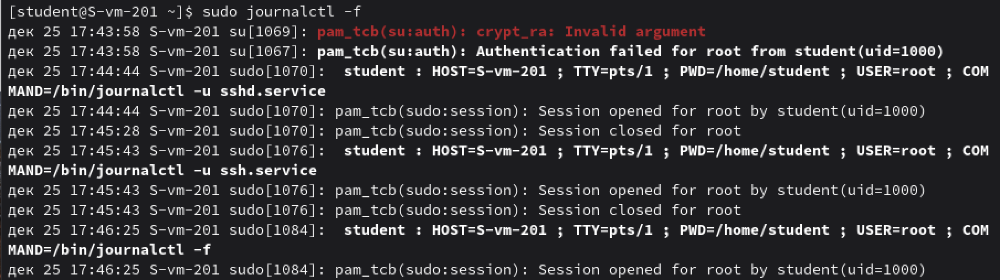
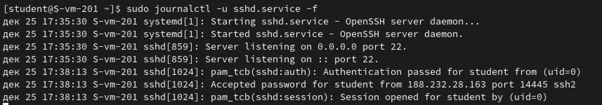
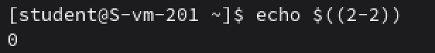

# Журнальчики

## 1. Посмотретите журналы ssh

ну вот sshd, просто

и вот ssh

## 2. Выведите журналы в реальном времени

`sudo journalctl -f`

-f показывает события журнала

## 3. Выведите лог в реальном времени для службы sshd

Та же команда, но с дополнением -u sshd, чтобы 

фильтрует журнал только по юниту sshd.service

## 4. Можно ли без комады journalctl прочитать логи systemd?

Да, можно, но неудобно

Логи systemd (journald) хранятся в бинарных файлах в каталогах, /run/log/journal/ — временные логи, /var/log/journal/ — постоянные логи

Можно копировать файлы из /var/log/journal/ и пытаться их читать как бинарные данные и можно использовать strings или hexdump, но это неструктурированный вывод

## 5. Сколько будет 2-2?

¯\_(ツ)_/¯