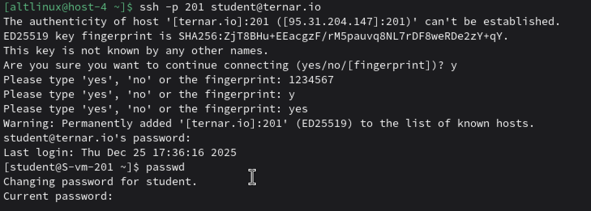
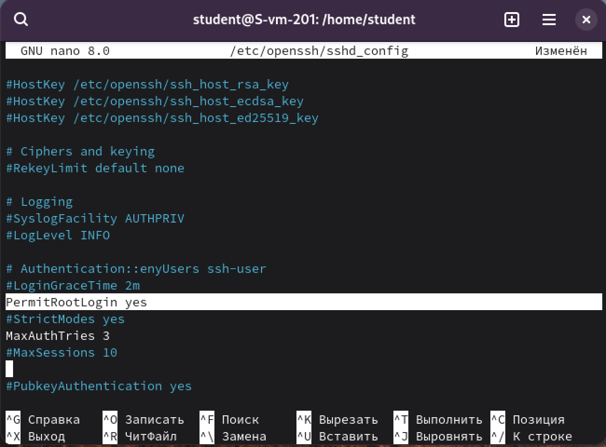
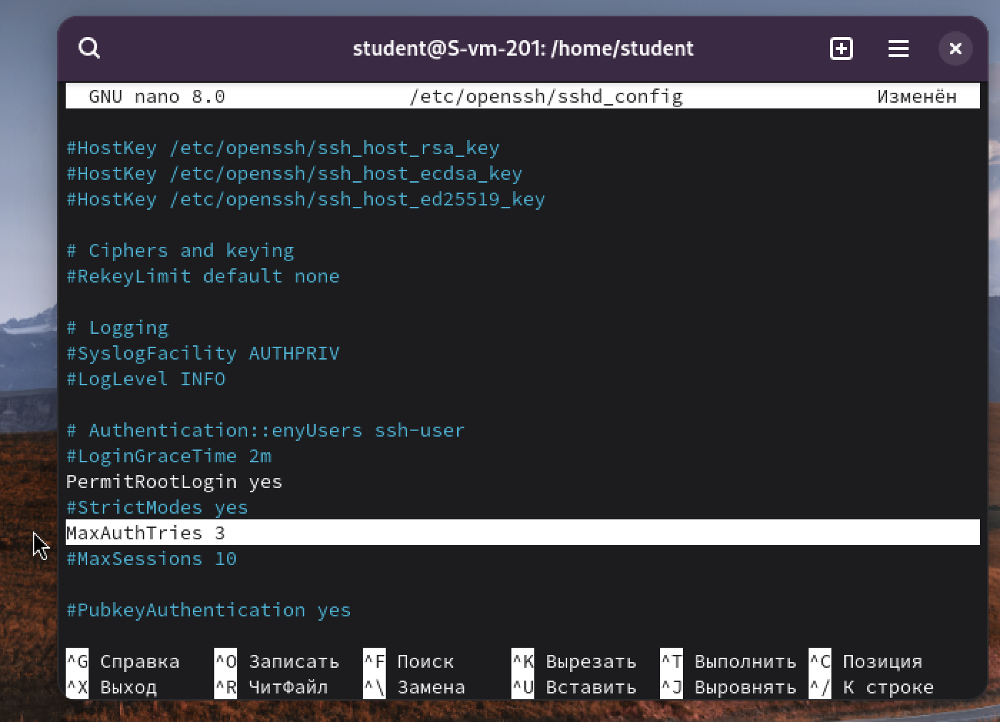
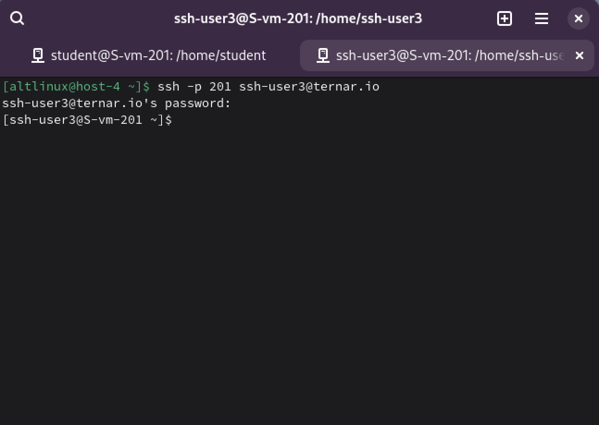
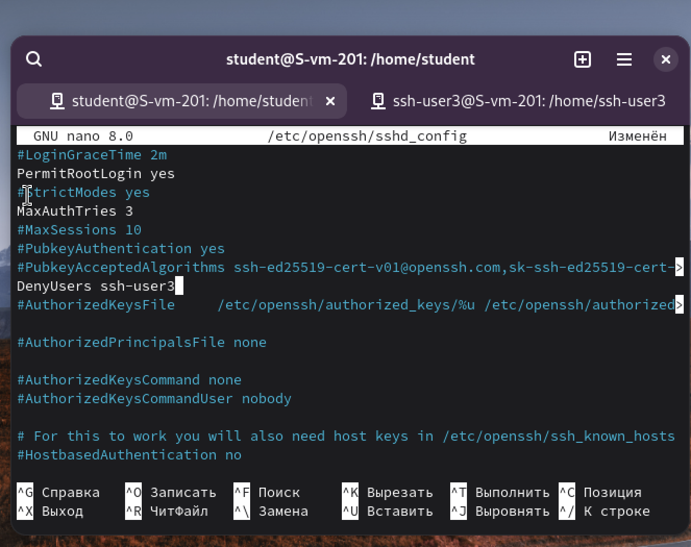

# Настриваем

## 1. Какой по умолчанию используется порт для поключения?

порт 22/tcp

## 2. Можно ли его изменить? если да то как?

Да, можно изменить.

Можно вот так:
`sudo nano /etc/ssh/sshd_config` Открыть конфиг SSH‑сервера с правами root

Найти строку `#Port 22`

убрать # и заменить порт, например `Port 228`

## 3. Какая служба отвечает за обработку запросов на подключения по ssh?

За обработку SSH-подключений отвечает служба sshd.

Это демон OpenSSH, который запускается при загрузке и слушает указанный порт, принимая входящие SSH-сессии.

## 4. Какой файл конфигурации отвечает за его настройку?

/etc/openssh/sshd_config

в нём задаются порт, разрешения на вход, аутентификация и другие параметры SSH-сервера

## 5. Попробуйте подключиться по ssh к предоставленному вам серверу

Подключилась. с трудом. И поменяла пароль сразу

Пароль поменять: passwd

## 6. Отредактируйте файл настроек на сервере так, чтобы была возможность подключиться к серверу используя пользователя root

`sudo nano /etc/openssh/sshd_config`

В файле /etc/openssh/sshd_config раскомментировала и изменила параметр PermitRootLogin на PermitRootLogin yes, после чего перезапустила службу sshd. Теперь root может подключаться по SSH.

## 7. Измените колличество ошибок ввода пароля перед сборосом соединения, покажите эти измененения

В том же файле, но MaxAuthTries 6 раскомментировала и поменяла на 3 попытки

## 8. Создайте пользователя ssh-user и попробуйте им подключиться к серверу

Создаю пользователя ssh-user3, потому что я не помню пароли от предыдущих. С помощью команды useradd и задаем ему пораль с помощью `sudo passwd ssh-user`

Видно, что в новой консольке я подключилась через ssh-user3. Работает.

## 9. Ограничте ему возможность подключения к серверу

Открыть конфиг: `sudo nano /etc/openssh/sshd_config`
добавляем DenyUsers ssh-user

## 10. Как вы это сделали?

В файле /etc/openssh/sshd_config добавляем DenyUsers ssh-user, что добавило нашего поользователя в чс. SSH-демон если увидит
в списке ssh-user3, то соединение сразу разорвется.

## 11. Что хранится в файле known_hosts?

лежит в домашнем каталоге клиента. содержит список хостов, к которым уже подключалась по SSH и их публичные host‑ключи