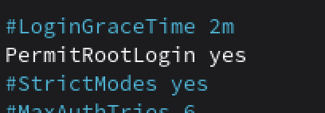
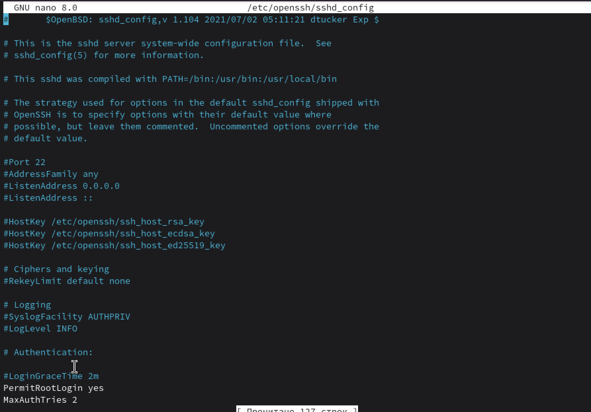

# Настриваем

1. Какой по умолчанию используется порт для поключения?

порт 22/tcp

2. Можно ли его изменить? если да то как?

Да, можно изменить.
Можно вот так:
`sudo nano /etc/ssh/sshd_config` Открыть конфиг SSH‑сервера с правами root
Найти строку `#Port 22`
убрать # и заменить порт, например `Port 228`

3. Какая служба отвечает за обработку запросов на подключения по ssh?

`sudo systemctl restart sshd`    или ssh

4. Какой файл конфигурации отвечает за его настройку?

`ssh -p 228 user@server`

5. Попробуйте подключиться по ssh к предоставленному вам серверу

Подключилась. с трудом. И поменяла пароль сразу

Пароль поменять: passwd

6. Отредактируйте файл настроек на сервере так, чтобы была возможность подключиться к серверу используя пользователя root
`sudo nano /etc/openssh/sshd_config`

В файле /etc/openssh/sshd_config раскомментировала и изменила параметр PermitRootLogin на PermitRootLogin yes, после чего перезапустила службу sshd. Теперь root может подключаться по SSH.

7. Измените колличество ошибок ввода пароля перед сборосом соединения, покажите эти измененения

8. Создайте пользователя ssh-user и попробуйте им подключиться к серверу

Пользователя я уже тоже создала, когда ssh искала, оказалось, что у нас openssh...
`sudo useradd -m -s /bin/bash ssh-user`
`sudo passwd ssh-user`
ssh -p 201 ssh-user@ternar.io

9. Ограничте ему возможность подключения к серверу

Открыть конфиг: `sudo nano /etc/openssh/sshd_config`
добавляем DenyUsers ssh-user
Это запретит вход по SSH только пользователю ssh-user
и потом `sudo systemctl restart sshd`

10. Как вы это сделали?

и для второго тож запрещаем

11. Что хранится в файле known_hosts?

лежит в домашнем каталоге клиента. содержит список хостов, к которым уже подключалась по SSH и их публичные host‑ключи
