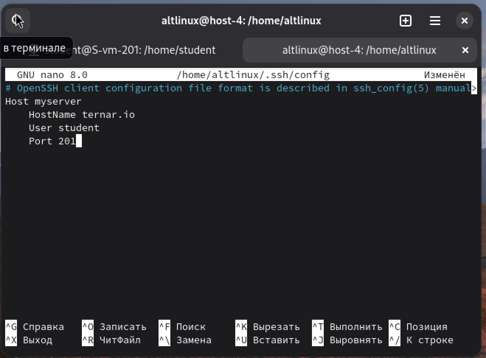
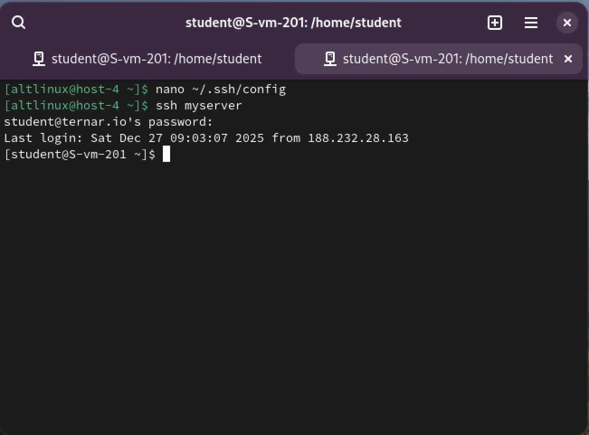

# Конфижим для удобства

1. Где хранятся пользвательские и системные настройки подключения?

Есть два уровня настроек SSH‑клиента - cистемные и пользовательские. 
Системные для всех пользователей `/etc/ssh/ssh_config`
Пользовательские только для текущего юзера `~/.ssh/config` файл в домашней папке пользователя. 

2. Что за файл options?

файл с настройками клиентского SSH, ~/.ssh
там описываются «профили» подключений, чтобы не писать каждый раз порт, пользователя и т.п.

3. Отредактируйте файл options так, чтобы можно было подключаться не вводя имя пользвателя и порт

Заходим через nano в `~/.ssh/config` и вписываем нужные данные о моем (вашем) сервере

4. Назовите подключение удобным для вас спсобом

пусть будет myserver

5. Проверьте работоспособность

Теперь, чттобы зайти на сервер, достаточно написать следующее:

*Подключилось!*