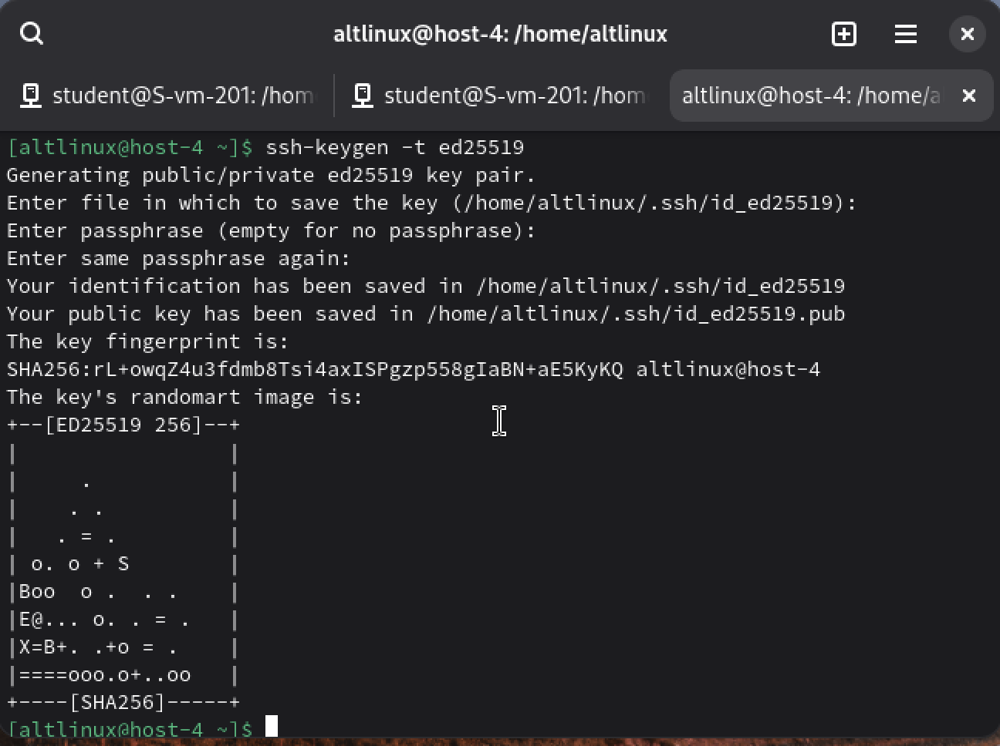
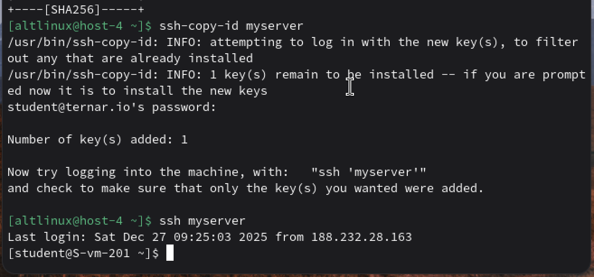
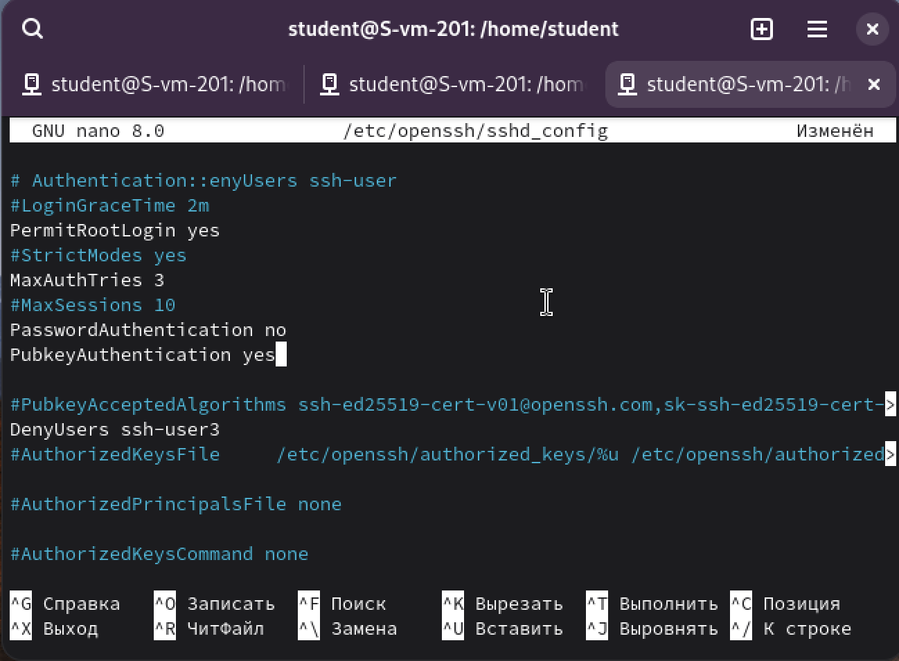

# Ключики

## 1. Что такое ssh ключи и зачем они нужны?

*SSH-ключи* — это криптографическая пара ключей, используемая для аутентификации при подключении по SSH

*Приватный ключ* — хранится только на клиенте (вашем компьютере) и должен быть секретиком

*Публичный ключ* — копируется на сервер и разрешает подключение тем, у кого есть соответствующий приватный ключ

## 2. Как их создать? 

Ключи создаются командой ssh-keygen на клиенте. Команда `ssh-keygen -t ed25519` генерирует приватный и публичный ключ.

Использется алгоритм ed25519.

## 3. Создайт пару публичный/приватный ключ ed_25519, где они хранятся?

Используем эту команду теперь, без пароля - enter просто. И ключи хранятся в скрытой папке .ssh в директории ~/.ssh/id_ed25519

## 4. Скопируйте публичный ключ на ваш сервер, в каком файле он будет храниться?

сдлеать это можно с помощью команды ssh-copy-id. После этого ключ будет сохранен на сервер в файл /home/user/.ssh/authorizwd_keys

## 5. Попробуйте подключиться к серверу, у вас запросили пароль?

Нет! Не попросили! Значит все скопировала правильно

## 6. Запретите подключение с паролем для всех пользователей, оставьте только с помощью ключа.

Чтобы разрешить вход только по ключу, нужно отключить аутентификацию по паролю на сервере.
​
Захожу на сервер и и открываю файл конфигурации SSH-сервера, там меняем 

PasswordAuthentication no

PubkeyAuthentication yes

запрещает вход по паролю

разрешает вход по ключу

