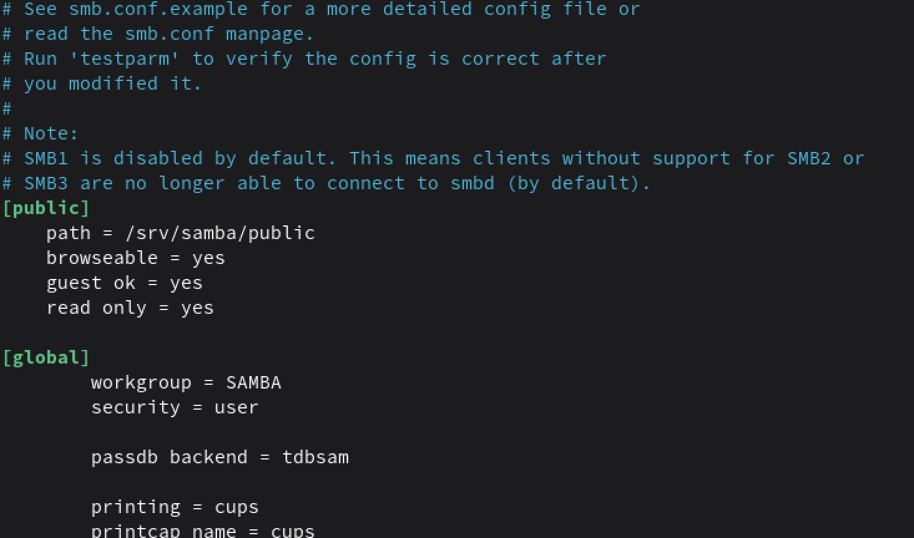
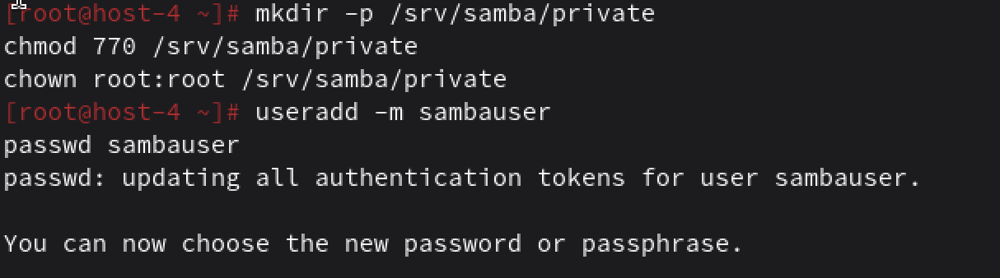
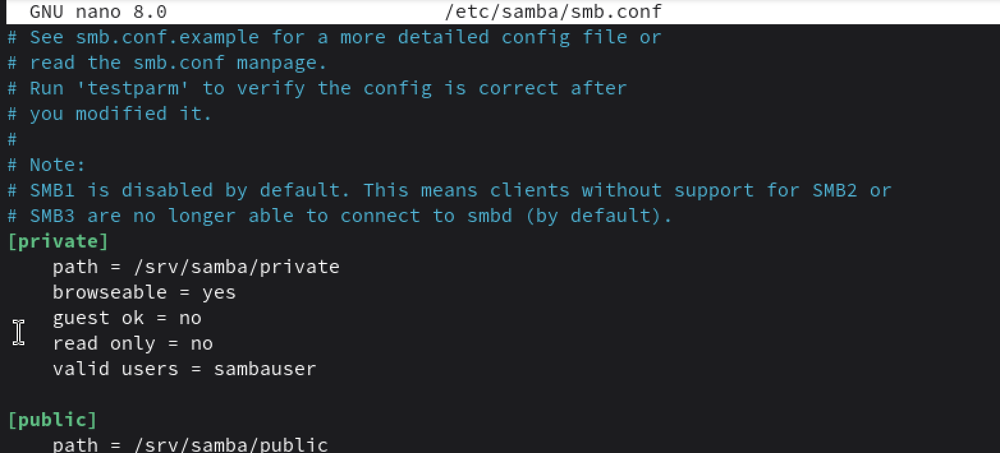
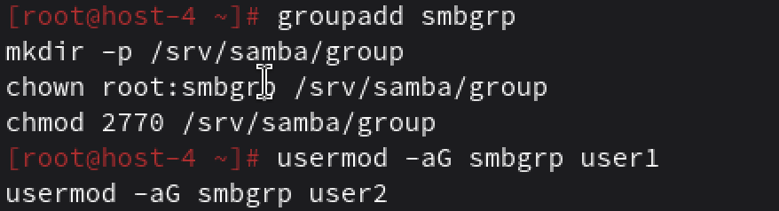
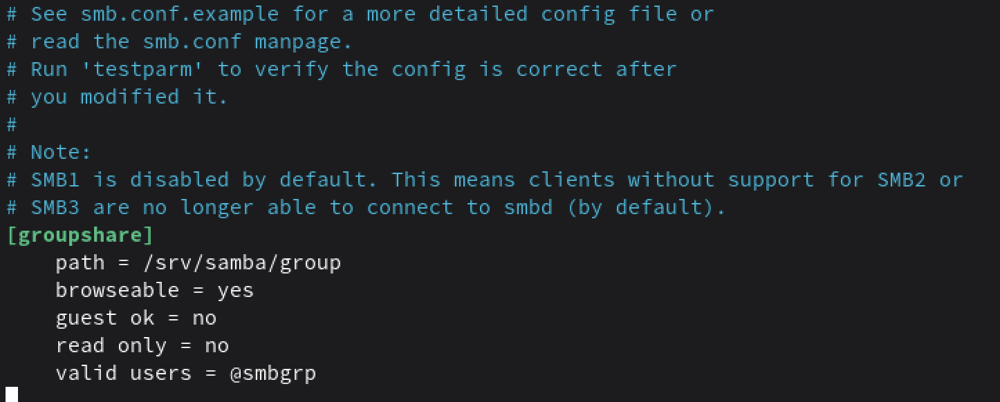
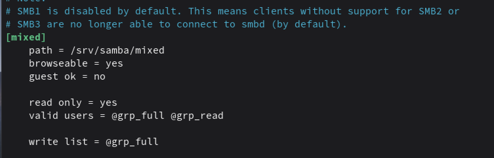

# Шарим


## 1. Установите пакет samba

Установила
```
apt-get update
apt-get install samba
```

## 2. ЧТо такое побщая папка, зачем оно может быть нужно?

Это каталог на сервере, к которому по сети могут обращаться другие компьютеры по протоколу SMB/CIFS.

Используется, чтобы централизованно хранить файлы, совместно работать над файлами в локальной сети, раздавать общие ресурсы

## 3. Создайте общую папку без пароля с правами только на чтение файлов

создаю каталог и права на него

```
mkdir -p /srv/samba/public
chmod 755 /srv/samba/public
```

потом с помощью нано в /etc/samba/smb.conf добавляю



все перезапускаю systemctl restart smb nmb

Теперь любой клиент в сети, не вводя логин/пароль, может подключиться к шару public, но только читать содержимое.

## 4. Создайте общую папку с паролем с правами на чтение и запись



опять пароль и 



## 5. Создайте общую папку с доступом для какой-то группы с полными правами

Создать группу и каталог:
```
groupadd smbgrp
mkdir -p /srv/samba/group
chown root:smbgrp /srv/samba/group
chmod 2770 /srv/samba/group 
```



В smb.conf:



Тогда только пользователи из группы smbgrp будут иметь полный доступ

## 6. Создайте общую папку в которой у одной группы будет полный доступ, а у другой только доступ на чтение.

Третья группа не должна иметь к ней доступа

Допустим, есть три группы:
*grp_full* — полный доступ;
*grp_read* — только чтение;
*grp_none* — доступа нет.

Создаем группы и каталог
```
groupadd grp_full
groupadd grp_read
groupadd grp_none

mkdir -p /srv/samba/mixed
chown root:grp_full /srv/samba/mixed
chmod 2770 /srv/samba/mixed
```

Добавляем пользователей

```
usermod -aG grp_full user_full1
usermod -aG grp_read user_read1
usermod -aG grp_none user_none1
```

Настройки в smb.conf



Только участники этих групп могут вообще подключиться к шару. Пользователи из grp_none даже не пройдут аутентификацию.

`read only = yes` — базовый режим: у всех только чтение.

`write list = @grp_full` — участникам grp_full Samba дополнительно даёт права на запись 

`grp_full` — полный доступ
`grp_read` — только чтение
`grp_none` — вообще не видят шар / не могут зайти.