# Шарим


## 1. Установите пакет samba

Установила
```
apt-get update
apt-get install samba
```
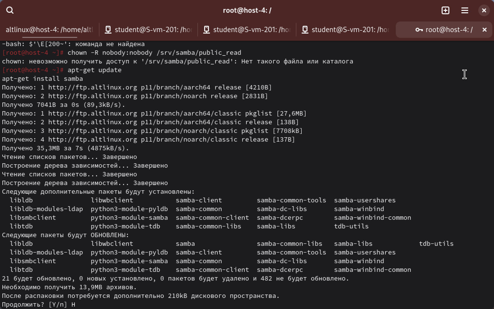

## 2. ЧТо такое общая папка, зачем оно может быть нужно?

это каталог на сервере, доступ к которому предоставляется по сети другим компьютерам через протокол SMB/CIFS.

Она нужна, чтобы обмениваться файлами между компьютерами в локальной сети, централизованно хранить документы, музыку, фильмы, организовать общий доступ для группы пользователей.

## 3. Создайте общую папку без пароля с правами только на чтение файлов

создаю каталог и права на него
```
kdir -p /srv/samba/public-read
chmod 755 /srv/samba/public-read
chown nobody:nobody /srv/samba/public-read
```
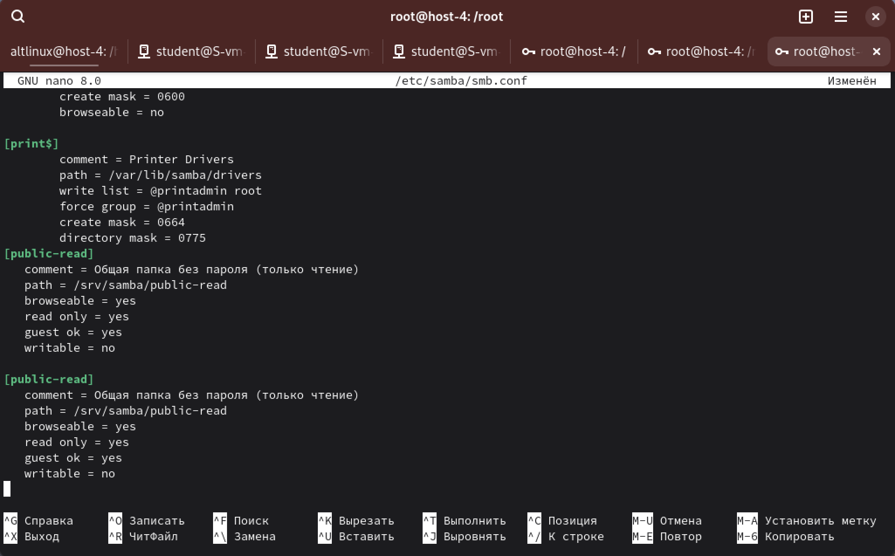

и создаю текстовый файл, который потом будем проверять

`ip a` узнаем айпи моей виртуалки

192.168.64.4

Открываю терминал и подключаюсь к Samba-шаре
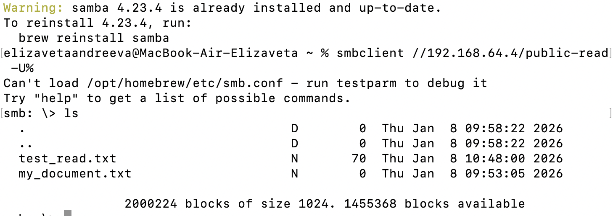

файл виден

Копируем файл с сервера на Mac

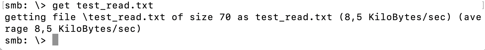

Проверяем чтение, где ! — команда выполняется на Mac, а не на Samba-сервере

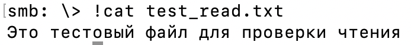

текст отображается — чтение работает

*Проверка записи:*

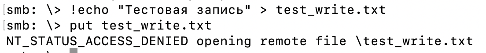

Запись запрещена ух ты

*Пробуем удалить файл test_read.txt:*

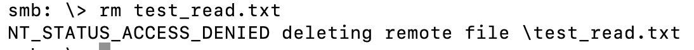

И удаление запрещено

Т.е папка public-read работает только как чтение

## 4. Создайте общую папку с паролем с правами на чтение и запись

Создаем пользователя user1, потом

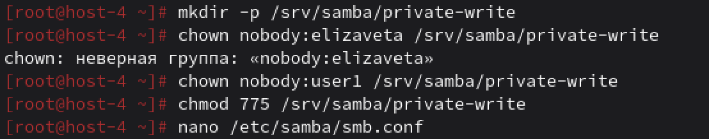

и добавляем в конец [private-write]

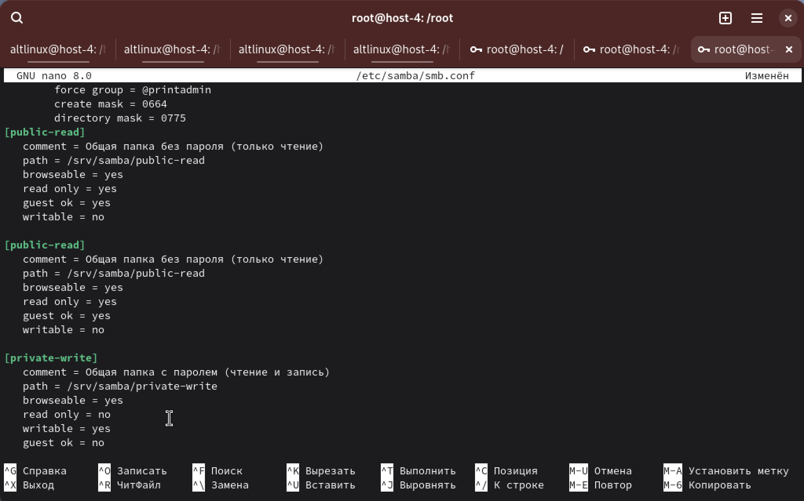

Проверяем через терминал

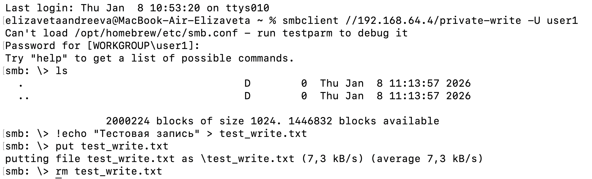

видно что запись и удаление работают.

## 5. Создайте общую папку с доступом для какой-то группы с полными правами

Создаем группу и добавляем пользователей. Затем создаём папку для шары и добавляем шару в /etc/samba/smb.conf.
В конце перезапускаем Samba.

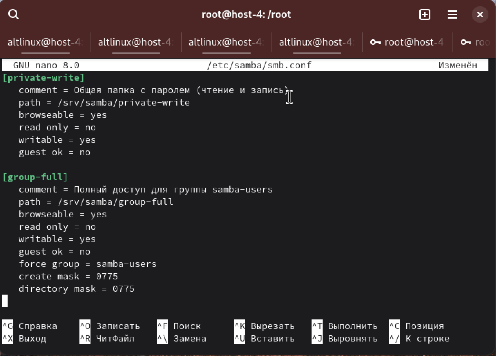

Открываю конфиг `nano /etc/samba/smb.conf`


 
 и перезапускаю samba `systemctl restart smb nmb`

Проверяю

 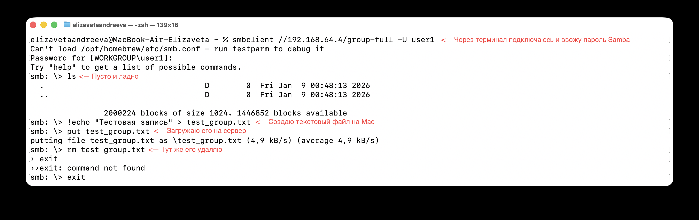

В папке можно создавать, изменять и удалять файлы. Папка group-full работает с паролем и даёт полный доступ для группы samba-users.

## 6. Создайте общую папку в которой у одной группы будет полный доступ, а у другой только доступ на чтение.

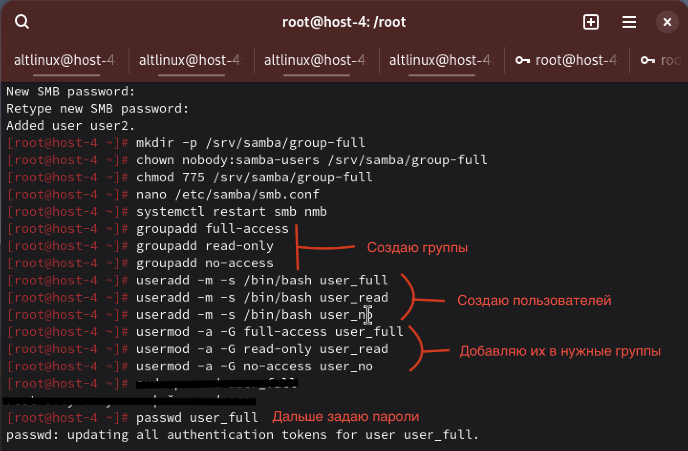

Дальше настраиваем права на файловой системе. Чтобы одна группа имела полный доступ, другая — только чтение, а третья — ничего, используем ACL.

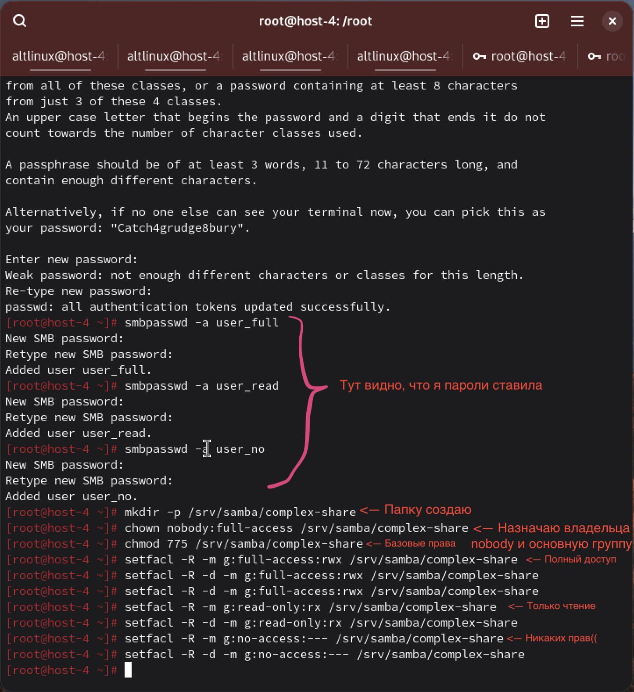

Добавляем шару в /etc/samba/smb.conf. Добавляю в конец:

```
[complex-share]
   comment = Разные права для групп
   path = /srv/samba/complex-share
   browseable = yes
   read only = no
   writable = yes
   guest ok = no
   force group = full-access
   create mask = 0775
   directory mask = 0775
```

и перезапускаю samba: `systemctl restart smb nmb`

*Проверяем:*

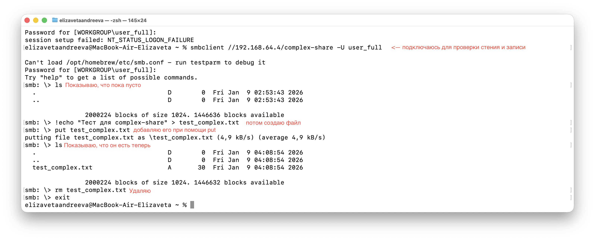

put и rm прошли без ошибок — запись и удаление работают, пользователь user_full имеет полный доступ.

аналогичная проверка для других подгрупп

Подключаемся под user_read - smbclient //192.168.64.4/complex-share -U user_read
ls работает, put выдаёт NT_STATUS_ACCESS_DENIED — только чтение.

Подключаемся под user_no - smbclient //192.168.64.4/complex-share -U user_no
Подключение не проходит — доступ запрещён.