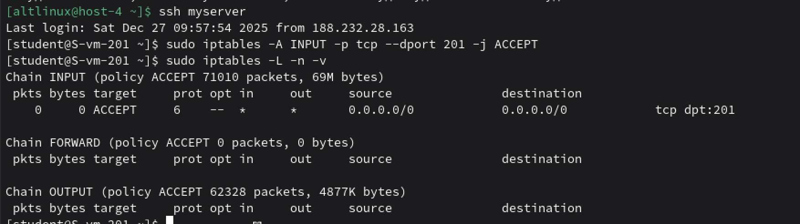
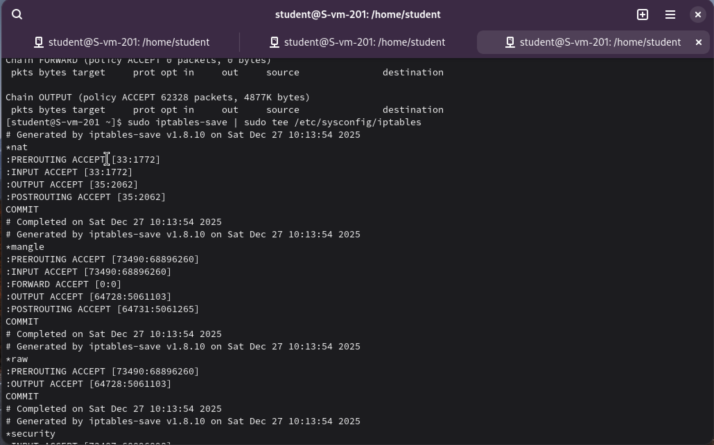

# Открываем iptables

## 1. Установите iptables

Установила

```
sudo apt-get update
sudo apt-get install iptables
```

## 2. Проверьте осталась ли возможность подключения по ssh к вашему серверу

Да

## 3. Почему может пропасть такая возможность?

SSH-подключение может пропасть, если:
- Включён фаервол (iptables) с политикой по умолчанию DROP или REJECT для входящих пакетов.
​- Не добавлено правило, разрешающее трафик на порт SSH
- Правило добавлено после запрещающего правила

## 4. Откройте нужный порт на сервере чтобы восстановить подключение

Открыть порт можно командой `sudo iptables -A INPUT -p tcp --dport 201 -j ACCEPT`



## 5. Это будет udp или tcp прот?

TCP порт, потому что ssh через него работает

# Сохраняем

## 6. Сохраняются ли записанные вами правила после перезагрузки?

Нет, по умолчанию правила iptables не сохраняются после перезагрузки

После перезагрузки система загружает только те правила, которые явно сохранены в файл и загружаются автоматически при старте системы.

## 7. Как их сохранить?

Чтобы правила iptables сохранялись после перезагрузки, нужно использовать команду iptables-save для сохранения правилв системный файл /etc/sysconfig/iptables

