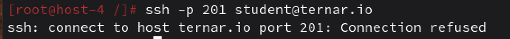

# Открываем iptables

1. Установите iptables

Установила

```
sudo apt-get update
sudo apt-get install iptables
```

2. Проверьте осталась ли возможность подключения по ssh к вашему серверу


чет не чет

3. Почему может пропасть такая возможность?

После включения firewall ошибка чаще всего в правилах.
Политика INPUT или FORWARD поставлена в DROP, но нет явного разрешения для SSH‑порта.
Неправильный интерфейс или протокол
Удалили старое разрешающее правило (iptables -F) и не добавили новое

4. Откройте нужный порт на сервере чтобы восстановить подключение
5. Это будет udp или tcp прот?

# Сохраняем

6. Сохраняются ли записанные вами правила после перезагрузки?
7. Как их сохранить?

При работе с firewall не рекомендую отключаться от текущей сессии ssh. Лучше подключаться из другой консольки.
