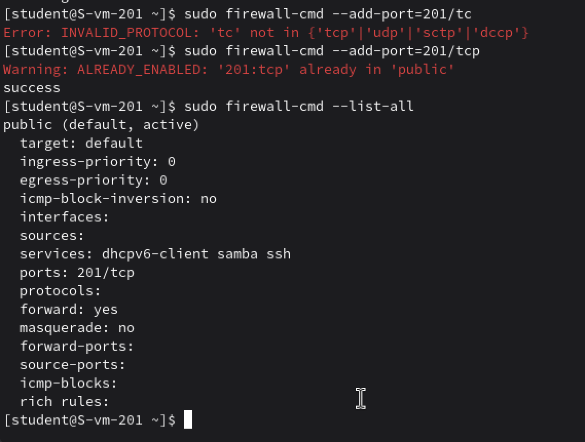
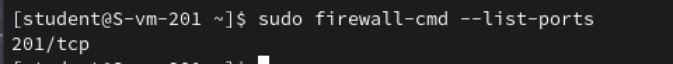
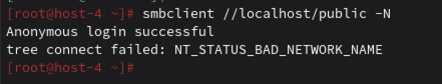

# Открываем firewald

## 1. Удалите iptables и установите firewalld

```
sudo apt-get remove iptables
sudo apt-get install firewalld
```

## 2. Попробуйте так-же проверить возможность подключения по ssh

Подключилось

## 3. Если её нет то откройте порт

Ладно, есть возможность, но открою порт `sudo firewall-cmd --add-port=201/tcp`



## 4. Выведите список открытых портов с помощью firewall-cmd



## 5. Можно ли там добавить порты по названию сервиса?

Да, в firewalld можно добавлять порты по названию сервиса, например

```
sudo firewall-cmd --permanent --add-service=http
sudo firewall-cmd --permanent --add-service=https
sudo firewall-cmd --permanent --add-service=samba
```

## 6. На вашей Локальной виртуальной машине попробуйте подключиться к серверу samba из предыдущих заданий



## 7. Если не получилось то откройте нужные порты

`sudo firewall-cmd --permanent --add-service=samba`

## 9. Сделайте так чтобы изменения были постоянными

По умолчанию команды firewall-cmd без --permanent действуют только до перезагрузки

Чтобы изменения сохранялись после перезагрузки используют флаг --permanent. После всех изменений `sudo firewall-cmd --reload`

Это загрузит постоянные правила в текущую конфигурацию.